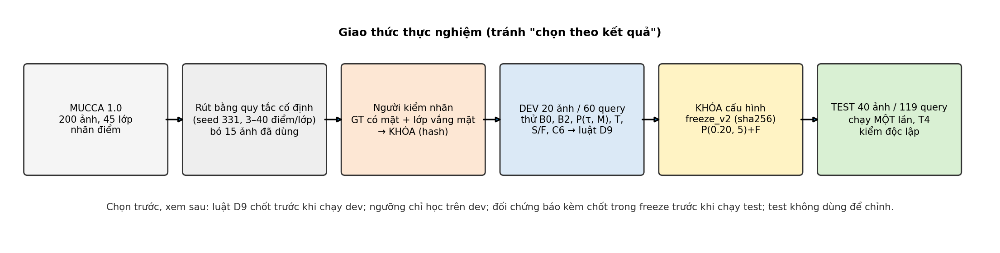
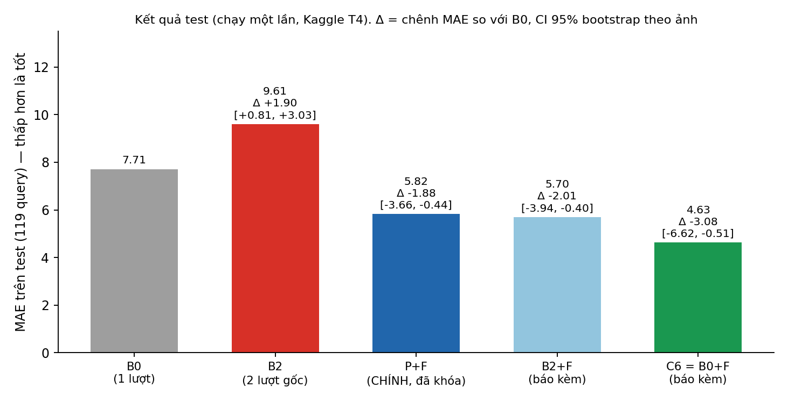
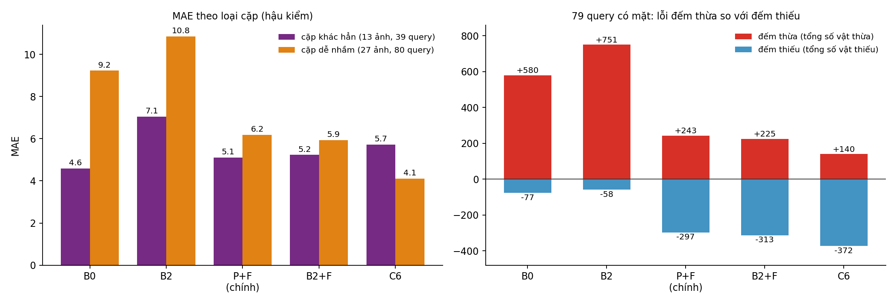
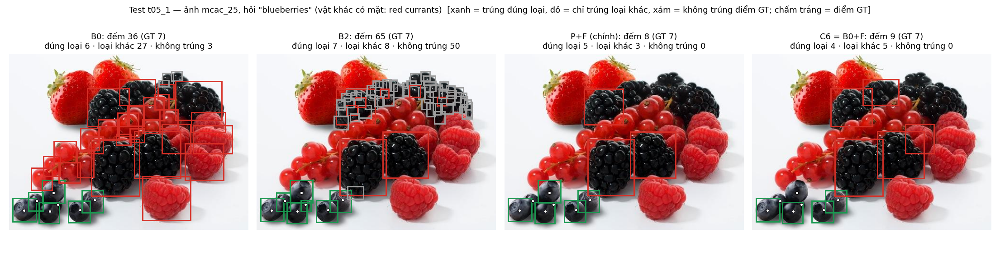
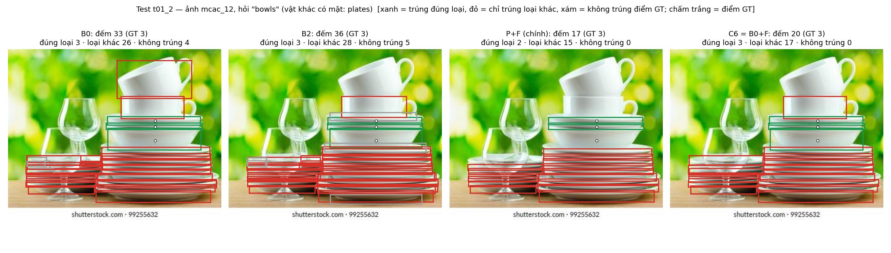
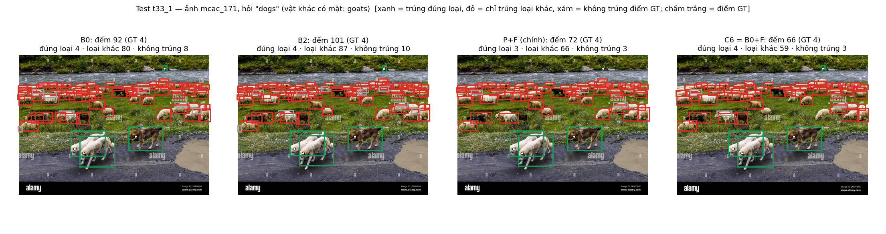
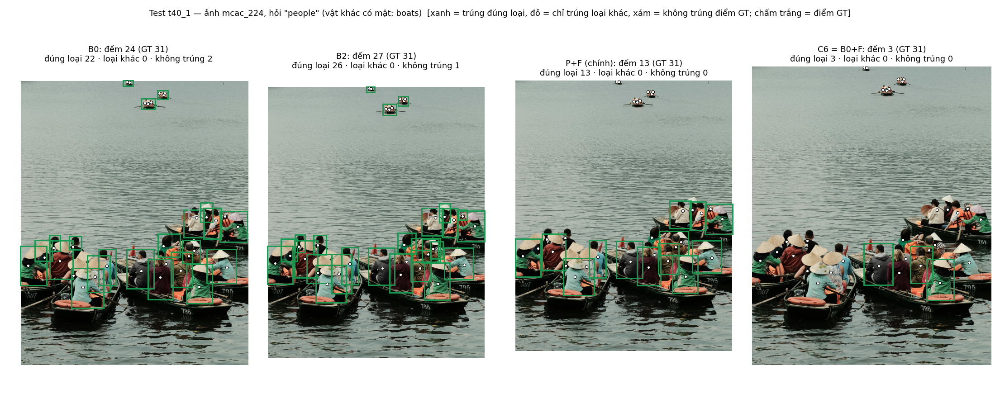

# Tóm tắt

Các mô hình đếm đối tượng hiện đại nhận một **câu chữ** (ví dụ "apples") và trả về số lượng vật đó trong ảnh, kể cả với loại vật chưa từng thấy khi huấn luyện (*zero-shot*). Các benchmark phổ biến chủ yếu có **một loại vật mỗi ảnh**, nên chưa kiểm tra một câu hỏi cơ bản: khi ảnh có nhiều loại, mô hình có **đếm đúng loại được hỏi** không?

Đồ án nghiên cứu câu hỏi này trên **CountGD++** (Amini-Naieni & Zisserman, 2025), một mô hình đếm theo câu chữ mạnh hiện nay, dùng ảnh nhiều loại vật của bộ **MUCCA** (Pacini và cộng sự, 2026). Nhóm không huấn luyện lại mô hình mà làm ba việc:

1. **Chẩn đoán.** Đo trực tiếp xem lỗi đến từ đâu. Kết quả: CountGD++ thường trả về **cùng một nhóm khung dù đổi câu hỏi**, và chế độ hai lượt tự chọn mẫu **làm lỗi nặng thêm**. Một phần nguyên nhân là cách chấm điểm lượt 2 lấy giá trị lớn nhất (max) giữa điểm theo chữ và điểm theo mẫu. Tuy vậy, bỏ riêng cách chấm này (biến thể T) chỉ gỡ được khoảng **1/5** tác hại trên dev (2/3 trên tập chẩn đoán 10 ảnh), và chưa đưa được kết quả về mức một lượt. Nhóm đặt giả thuyết rằng phần còn lại đến từ việc mẫu giả làm lệch cách mô hình hiểu câu chữ. Giả thuyết này chưa được kiểm trực tiếp.
2. **Đề xuất cải tiến không cần huấn luyện:**
   - **P:** dùng CLIP kiểm mẫu tự chọn trước lượt 2;
   - **F:** lọc khung bằng cách kết hợp điểm CountGD++ với điểm CLIP theo đúng câu chữ được hỏi.
3. **Đánh giá theo giao thức "chọn trước, xem sau".** Dữ liệu được người kiểm và khóa trước. Cấu hình được chọn trên tập dev bằng một luật đã chốt từ trước, khóa lại, rồi chạy tập test **đúng một lần**.

Trên tập test 40 ảnh / 119 câu hỏi:

- cấu hình đã khóa P+F giảm sai số tuyệt đối trung bình (MAE) từ **7.71 xuống 5.82** so với CountGD++ một lượt (khoảng tin cậy 95%: [−3.66, −0.44]);
- cơ chế hai lượt gốc **làm kém đi** (9.61; so với B0: +1.90, CI [+0.81, +3.03]).

Phân tích sâu hơn cho thấy:

- thành phần thực sự có ích là **bộ lọc F**, còn bước P gần như luôn chọn lại đúng bộ mẫu cũ;
- F chủ yếu **đổi lỗi đếm thừa thành đếm thiếu**;
- cải thiện tập trung ở **cặp vật dễ nhầm** (cùng nhóm: các loại quả, bát–đĩa…); với cặp vật khác hẳn nhau, chưa thấy khác biệt rõ so với một lượt.

# Cách đọc tài liệu

- **Mục 1–3** trả lời câu hỏi *"đồ án làm gì, vì sao"*.
- **Mục 4–5** trả lời *"làm như thế nào"*.
- **Mục 6–7** trả lời *"được gì, hiểu được gì"*.
- **Mục 8–10** gồm hạn chế, kết luận và việc còn lại.

Các phân tích đánh dấu **(hậu kiểm)** được làm *sau khi* đã có kết quả test, chỉ để giải thích. Chúng không được dùng để chọn hay đổi phương pháp.

**Bảng thuật ngữ**

| Thuật ngữ | Nghĩa trong đồ án |
|---|---|
| Zero-shot counting | Đếm loại vật mà mô hình không được huấn luyện riêng; loại vật được chỉ định lúc dùng bằng câu chữ |
| Query (câu hỏi) | Một cặp (ảnh, tên loại vật), ví dụ (ảnh bàn ăn, "bowls") |
| Có mặt / vắng mặt | Loại được hỏi có / không có trong ảnh. Câu hỏi vắng mặt có đáp án đúng là 0 |
| Khung (box) | Hình chữ nhật mô hình khoanh quanh một vật nó cho là đúng loại; số đếm = số khung được giữ |
| Mẫu (exemplar) | Một khung mẫu đưa thêm vào mô hình để chỉ "vật trông như thế này" |
| Mẫu giả (pseudo-exemplar) | Mẫu do chính mô hình tự chọn từ lượt chạy đầu, không do người vẽ |
| CLIP | Mô hình nối ảnh với chữ: cho biết một ô ảnh giống câu "a photo of X" tới mức nào |
| GT (ground truth) | Đáp án đúng; ở đây là số điểm người gán cho từng loại vật trong ảnh MUCCA |
| MAE | Sai số tuyệt đối trung bình của số đếm (nhỏ hơn là tốt) |
| FPR_absent | Tỉ lệ câu hỏi vắng mặt mà mô hình báo nhầm là có (đếm > 0) |
| dev / test | Tập dùng để chọn cách làm / tập chỉ dùng một lần để đo kết quả cuối |
| Bootstrap theo ảnh | Cách ước lượng độ chắc chắn của chênh lệch bằng cách lấy mẫu lại các *ảnh* |

# 1. Giới thiệu và câu hỏi nghiên cứu

## 1.1 Bối cảnh

Đếm đối tượng có nhiều ứng dụng: đếm người, xe, hàng hóa, tế bào, trái cây. Các phương pháp cũ huấn luyện riêng cho từng loại vật. Hướng **đếm không phân biệt lớp** (class-agnostic) nới yêu cầu đó: người dùng chỉ định loại vật lúc dùng, bằng vài khung mẫu hoặc bằng câu chữ.

- Bộ FSC-147 (Ranjan và cộng sự, 2021) là benchmark chuẩn cho hướng này.
- **CountGD** (Amini-Naieni, Han & Zisserman, 2024) cải tạo mô hình phát hiện vật theo câu chữ GroundingDINO (Liu và cộng sự, 2024) thành mô hình đếm. Mô hình nhận câu chữ, khung mẫu, hoặc cả hai.
- **CountGD++** (Amini-Naieni & Zisserman, 2025) mở rộng thêm: mẫu giả tự sinh lúc suy luận, mẫu từ ảnh ngoài, và câu chỉ định "không đếm cái gì".

## 1.2 Vấn đề

Ảnh trong FSC-147 thường chỉ có một loại vật nổi bật. Một mô hình có thể đạt điểm cao **mà không thật sự hiểu câu chữ**: chỉ cần "đếm thứ nổi bật nhất trong ảnh".

- Ciampi và cộng sự (2025) chỉ ra điều này bằng bộ kiểm PrACo.
- Pacini và cộng sự (2026) xây bộ **MUCCA**: ảnh thật, nhiều loại vật cùng được gán nhãn trong một ảnh. Kèm bộ kiểm PrACo++, gồm (i) hỏi loại vắng mặt và (ii) đếm khi có vật gây nhiễu. Nhóm tác giả báo rằng các mô hình mạnh vẫn yếu ở khả năng bám đúng câu chữ.

Đồ án đặt câu hỏi theo dạng thầy nêu (gọi là **bài toán X/Y**). Trong cùng một ảnh có hai loại vật X và Y:

- hỏi X thì phải đếm X;
- đổi sang hỏi Y thì phải đếm Y, **không được đếm lại vật của X**;
- hỏi một loại Z không có trong ảnh thì phải trả 0.

## 1.3 Câu hỏi nghiên cứu

- **RQ1 (chẩn đoán):** CountGD++ sai ở đâu khi ảnh có nhiều loại vật? Lỗi đến từ bước nào?
- **RQ2 (cải tiến):** Có thể giảm lỗi đó mà **không huấn luyện lại** mô hình không, chỉ bằng các bước kiểm tra thêm ở đầu ra?
- **RQ3 (kiểm chứng):** Mức cải thiện có còn đúng trên **ảnh chưa từng dùng**, khi cấu hình đã khóa trước không?

## 1.4 Đóng góp của đồ án

1. Một **chẩn đoán định lượng** về lỗi đếm nhầm loại của CountGD++:
   - chỉ ra một cơ chế cụ thể ở lượt 2 (cách chấm max) và **đo mức đóng góp** của nó bằng biến thể T: cơ chế này chỉ giải thích một phần tác hại (khoảng 1/5 trên dev);
   - các phép đo trực tiếp: khung dùng chung giữa X và Y, khung trúng đúng loại theo điểm GT.
2. Hai bước cải tiến **không cần huấn luyện** (P và F). Có so sánh tách bạch để biết bước nào thật sự có ích.
3. Một **giao thức đánh giá chặt**:
   - dữ liệu rút theo quy tắc cố định và được người kiểm;
   - luật chọn cấu hình chốt trước;
   - cấu hình khóa bằng mã băm (hash), test chạy một lần;
   - người thứ hai tính lại độc lập.
4. **Kết quả trung thực**, kể cả phần âm: lượt 2 gây hại; P không đóng góp; thứ hạng dev đảo trên test; cặp khác hẳn chưa cải thiện.

# 2. Kiến thức nền

## 2.1 CountGD++ đếm như thế nào (mức đủ dùng cho đồ án)

CountGD++ kế thừa khung **phát hiện vật theo câu chữ** của GroundingDINO. Phần này mô tả theo đúng cách mã nguồn CountGD++ được dùng trong đồ án (`CountGDPlusPlus/process_folder.py`).

1. Ảnh và câu chữ (ví dụ "bowls .") được mã hóa. Mô hình sinh ra **nhiều khung đề xuất**.
2. Mỗi khung có một **điểm cho từng token** của câu nhắc. Nếu có mẫu, mỗi mẫu cũng chiếm token riêng; đồ án gọi đó là token mẫu (id 1008).
3. **Điểm của một khung = giá trị lớn nhất** trong các token trước dấu chấm.
4. Khung có điểm **lớn hơn 0.23** được giữ lại. **Số đếm = số khung được giữ.**

Đồ án dùng checkpoint công khai, không huấn luyện lại, với hai chế độ:

- **B0**: chạy một lượt, chỉ có câu chữ.
- **B2**: chạy lượt 1 như B0; lấy tối đa 3 khung điểm cao nhất (điểm > 0.23) làm **mẫu giả**; chạy **lượt 2** với câu chữ + mẫu giả. Nếu lượt 1 không có khung nào qua ngưỡng thì trả kết quả B0.

> Hình dung đời thường: lượt 1 giống người đếm đọc tên vật rồi khoanh những thứ trông giống. Lượt 2 giống việc người đó chỉ vào 3 vật mình chắc nhất, rồi nói "đếm hết những thứ trông như mấy cái này". Nếu 3 vật được chỉ vào sai loại, lượt 2 sẽ đếm sai một cách rất "tự tin".

## 2.2 CLIP

CLIP (Radford và cộng sự, 2021) học từ rất nhiều cặp ảnh–chú thích, gồm hai bộ mã hóa: một cho ảnh, một cho chữ. Độ giống giữa một ô ảnh và một câu là **cosine** giữa hai vector đã chuẩn hóa. Trong đồ án:

- mỗi khung được cắt ra (crop) rồi so với câu `a photo of {X}`;
- model `openai/clip-vit-base-patch32`, có ghi revision cố định;
- **CLIP không đếm.** CLIP chỉ đóng vai *người kiểm tra thứ hai*, xác nhận một khung có giống loại được hỏi không.

## 2.3 Công trình liên quan (sẽ được Triệu viết đầy đủ ở báo cáo cuối)

- **Đếm theo mẫu / theo chữ:** FSC-147 và các phương pháp đếm theo mẫu; CountGD, CountGD++; các phương pháp tự sinh mẫu từ chữ (PseCo, DAVE, VA-Count), sẽ đối chiếu chi tiết trong phần Related Work.
- **Đánh giá độ bám câu chữ:** PrACo (Ciampi và cộng sự, 2025), PrACo++ và MUCCA (Pacini và cộng sự, 2026). Đồ án dùng chung tinh thần (hỏi loại vắng mặt, ảnh có vật gây nhiễu). Khác ở chỗ: đồ án tập trung *sửa* lỗi cho một mô hình cụ thể và kiểm bằng giao thức khóa trước.

# 3. Định nghĩa bài toán và cách đo

## 3.1 Bài toán

Cho ảnh $I$ có tập loại vật được gán nhãn $\mathcal{C}(I)$; mỗi loại $c$ có số lượng thật $n_c(I)$. Một câu hỏi là cặp $q = (I, t)$, với $t$ là tên loại. Mô hình trả về số đếm $\hat{n}(I, t)$. Yêu cầu:

- **(Y1) Có mặt:** nếu $t \in \mathcal{C}(I)$ thì $\hat{n}(I,t) \approx n_t(I)$.
- **(Y2) Vắng mặt:** nếu $t \notin \mathcal{C}(I)$ và vật đó thật sự không có trong ảnh, thì $\hat{n}(I,t) = 0$.
- **(Y3) Độc lập X/Y:** với $X \ne Y$ cùng có mặt, tập khung trả về cho $X$ và cho $Y$ phải **khác nhau**: mỗi khung chỉ thuộc về vật của đúng loại được hỏi.

Mỗi ảnh trong dữ liệu đánh giá có **2 câu hỏi có mặt (X, Y) + 1 câu hỏi vắng mặt (Z)**. Z được chọn "khó": cùng nhóm nghĩa với Y nếu có thể, và người kiểm xác nhận Z thật sự không có trong ảnh.

## 3.2 Chỉ số

Với tập câu hỏi $Q$, sai số của câu $q$ là $e_q = \hat{n}_q - n_q$, với $n_q = 0$ nếu $q$ vắng mặt.

$$\text{MAE} = \frac{1}{|Q|}\sum_{q\in Q} |e_q|, \qquad \text{RMSE} = \sqrt{\frac{1}{|Q|}\sum_{q\in Q} e_q^2}, \qquad \text{FPR}_{\text{absent}} = \frac{\#\{q \text{ vắng mặt}: \hat{n}_q > 0\}}{\#\{q \text{ vắng mặt}\}}.$$

- MAE là chỉ số chính, báo trên cả tập, riêng câu có mặt, và kèm FPR_absent.
- RMSE nhạy với lỗi rất lớn, vì bình phương sai số.
- **Đếm thừa / đếm thiếu:** $\sum_{e_q>0} e_q$ và $\sum_{e_q<0} |e_q|$. Hai con số này cho biết mô hình sai theo hướng nào.

**Chỉ số cho Y3 (hậu kiểm):**

- **Tỉ lệ khung dùng chung X/Y**: phần trăm khung của X (và của Y) có khung trùng trong câu trả lời của câu kia, với IoU ≥ 0.5. IoU là diện tích giao chia diện tích hợp của hai khung.
- **Kiểm theo điểm GT:** MUCCA đánh dấu tâm từng vật kèm loại, nên mỗi khung được xếp thành:
  - *đúng loại*: chứa điểm của loại được hỏi;
  - *chỉ loại khác*: chỉ chứa điểm của loại khác;
  - *không trúng*: không chứa điểm nào.

## 3.3 Vì sao lấy khoảng tin cậy theo **ảnh**

Ba câu hỏi trong cùng một ảnh không độc lập: ảnh khó thì cả ba thường cùng sai. Nếu lấy mẫu lại theo câu hỏi, khoảng tin cậy sẽ hẹp giả tạo.

Vì vậy đồ án dùng **bootstrap theo ảnh** (Efron, 1979): lấy ngẫu nhiên có hoàn lại 40 ảnh, tính chênh lệch MAE giữa hai cách, lặp 5000 lần (seed 331), rồi lấy phân vị 2.5% và 97.5%. Nếu khoảng này **không chứa 0** thì chênh lệch được coi là đủ chắc ở mức 95%.

# 4. Phương pháp

## 4.1 Chẩn đoán cơ chế lỗi của lượt 2

Đọc mã của CountGD++ cho thấy, ở lượt 2, dãy token được lấy giá trị lớn nhất gồm **cả token chữ lẫn token mẫu**:
$$s_{\text{lượt 2}}(b) = \max\big(\underbrace{s_{\text{chữ}}(b)}_{\text{giống "bowls"?}},\ \underbrace{s_{\text{mẫu}}(b)}_{\text{giống mẫu giả?}}\big).$$

Hệ quả: một khung chỉ cần **giống mẫu giả** là có điểm cao, dù không giống câu chữ. Nếu mẫu giả rơi vào vật loại khác (ví dụ khoanh chó khi hỏi người), lượt 2 sẽ tự tin đếm thêm vật loại đó.

**Giả thuyết H1:** tác hại của lượt 2 là do cách chấm max.

**Phép thử:** biến thể **T** giữ nguyên lượt 2 (cùng mẫu giả của B2) nhưng chỉ chấm khung bằng token chữ, tức bỏ max. Nếu H1 đúng hoàn toàn, T phải về gần B0. Kết quả (khoảng tin cậy tính hậu kiểm ngày 15/11, bootstrap theo ảnh):

| Tập | B0 (1 lượt) | T (bỏ max) | B2 (có max) | Phần tác hại T gỡ được = (B2 − T)/(B2 − B0) | T so với B0 |
|---|---:|---:|---:|---|---|
| dev v2 (20 ảnh, 60 câu) | 6.28 | 8.55 | 9.15 | **21%** [5%, 60%] | +2.27 [+0.52, +4.12] |
| p4_unseen_v1 (10 ảnh, 30 câu; tập chẩn đoán) | 6.77 | 8.80 | 13.00 | 67% | +2.03 [−0.37, +5.33] |

Đọc kết quả:

- Bỏ max **có giúp**: trên dev, B2 − T = +0.60, CI [+0.12, +1.23].
- Nhưng **không khắc phục triệt để**: ở cả hai tập T vẫn kém B0; trên dev, khoảng tin cậy không chứa 0.
- Tỉ lệ gỡ được **dao động mạnh** giữa hai tập (21% và 67%), và khoảng tin cậy trên dev rất rộng. Vì vậy nhóm chỉ kết luận được rằng **cách chấm max giải thích một phần, chưa phải toàn bộ** tác hại của lượt 2.

**Giả thuyết H2 (chưa kiểm):** mẫu giả còn làm thay đổi chính điểm theo chữ. Token mẫu và token chữ đi cùng nhau qua các lớp kết hợp đặc trưng của mô hình, nên ở lượt 2, điểm "giống bowls" của một khung có thể đã bị kéo theo mẫu giả ngay từ đầu. Hình dung: người đếm vừa được chỉ cho xem vài vật, nên nhìn gì cũng thấy giống vật đó.

Cách kiểm đề xuất: so điểm token chữ của **cùng một khung** ở lượt 1 và lượt 2. Đây mới là quan sát và giả thuyết, chưa phải kết luận. Bằng chứng định tính từ pilot và review khung bằng người (N4, mục 6.4) phù hợp với cả H1 lẫn H2.

## 4.2 Các biến thể

| Ký hiệu | Mô tả | Vai trò |
|---|---|---|
| **B0** | CountGD++ một lượt, chỉ chữ, ngưỡng 0.23 | Mốc so sánh chính |
| **B2** | CountGD++ hai lượt với 3 mẫu giả tự chọn | Cơ chế gốc của CountGD++ |
| **P** (τ, M) | Như B2, nhưng trước lượt 2 xét **M** ứng viên điểm cao nhất của lượt 1; chỉ giữ ứng viên có cosine CLIP với "a photo of X" **≥ τ**; lấy tối đa 3 theo điểm CountGD++. Không còn ứng viên thì trả B0 | Sửa *đầu vào* của lượt 2 |
| **T** | Ở lượt 2 chỉ chấm khung bằng **token chữ**, bỏ phần max với token mẫu | Sửa *cách chấm* lượt 2 |
| **S** | Lọc khung đầu ra bằng một ngưỡng điểm CountGD++ cao hơn 0.23 | Lọc đơn giản |
| **F** | Lọc khung bằng **điểm kết hợp CountGD++ + CLIP** (mục 4.3) | Lọc có "người kiểm thứ hai" |
| **C6** | B0 + F, bỏ hẳn lượt 2 | Đối chứng bắt buộc |

Các tổ hợp cũng được thử: P+F, B2+F, P+T, P+T+F, B0+S…

## 4.3 Bộ lọc Fusion F

Với mỗi khung $b$ có điểm CountGD++ $a_b$ và cosine CLIP $c_b$, đưa từng điểm về [0, 1] bằng min–max:
$$\tilde{a}_b = \mathrm{clip}\Big(\frac{a_b - a_{\min}}{a_{\max}-a_{\min}},0,1\Big),\quad \tilde{c}_b = \mathrm{clip}\Big(\frac{c_b - c_{\min}}{c_{\max}-c_{\min}},0,1\Big),\quad F_b = 0.5\,\tilde{a}_b + 0.5\,\tilde{c}_b.$$

Khung được giữ nếu $F_b \ge \theta$. Giá trị $a_{\min}, a_{\max}, c_{\min}, c_{\max}, \theta$ được **học trên dev rồi khóa**. Với cấu hình chính: $a\in[0.231, 0.982]$, $c\in[0.123, 0.335]$, $\theta = 0.604$.

**Ví dụ số thật** (test t05_1, hỏi "blueberries", ảnh có 5 loại quả; $a$ = điểm CountGD++, $c$ = cosine CLIP, $\theta$ = 0.604):

| # | $a$ | $c$ | $\tilde a$ | $\tilde c$ | $F$ | Giữ? | Vật thật (theo điểm GT) |
|---|---:|---:|---:|---:|---:|---|------------------|
| 1 | 0.911 | 0.251 | 0.905 | 0.601 | **0.753** | giữ | việt quất ✓ |
| 2 | 0.761 | 0.215 | 0.706 | 0.435 | 0.571 | **bỏ** | việt quất (bỏ nhầm ✗) |
| 3 | 0.888 | 0.274 | 0.875 | 0.711 | 0.793 | giữ | quả khác (giữ nhầm ✗) |
| 4 | 0.727 | 0.218 | 0.660 | 0.448 | 0.554 | bỏ | không có vật (✓) |

Ví dụ cho thấy cả mặt mạnh lẫn mặt yếu:

- F bỏ được khung rác (khung 4);
- nhưng có thể bỏ nhầm vật đúng (khung 2);
- và vẫn giữ vật sai loại khi CLIP cũng nhầm (khung 3).

Tổng cộng, ở câu này, mô hình chính giữ 8/65 khung (GT = 7).

## 4.4 Vì sao không huấn luyện lại

1. Đồ án muốn trả lời câu hỏi về **chính mô hình công khai**.
2. Dữ liệu nhiều loại có nhãn ít (MUCCA có 200 ảnh), không đủ để huấn luyện lại mà vẫn còn tập kiểm độc lập.
3. Cách sửa ở đầu ra dễ tái lập, chạy được trên GPU 4 GB / Kaggle T4.

# 5. Dữ liệu và giao thức thực nghiệm

## 5.1 Dữ liệu

- **FSCD-147** (1.190 ảnh test): chỉ dùng để **kiểm môi trường chạy** CountGD++ (mục 6.1).
- **MUCCA 1.0** (Zenodo 19231375, CC-BY-4.0): 200 ảnh, 45 loại vật, **nhãn điểm theo từng loại** trong cùng ảnh. Đồ án dùng 4 tập rời nhau:

| Tập | Ảnh / câu hỏi | Dùng để |
|---|---|---|
| Pilot | 5 / 15 (toàn câu có mặt) | Tìm lỗi, thiết kế cải tiến v1 |
| p4_unseen_v1 | 10 / 30 | Kiểm cải tiến v1 trên ảnh mới; review khung bằng người (N4) |
| **dev v2** | 20 / 60 | Thử các biến thể, chọn cấu hình v2 |
| **test v2** | 40 / 120 (chấm 119) | Đo kết quả cuối, **chạy một lần** |

**Quy tắc rút dev/test v2** (script `select_dev_test_v2.py`, chỉ đọc nhãn, không đọc output mô hình):

- bỏ 15 ảnh đã dùng ở pilot và p4_unseen_v1;
- mỗi ảnh chọn một cặp có mặt (X, Y), mỗi loại có 3–40 điểm, để người kiểm bằng mắt được;
- **lấy hết** các ảnh có cặp *khác hẳn* (khác siêu nhóm, ví dụ người–xe). Phần còn lại lấy cặp *dễ nhầm* (cùng siêu nhóm, ví dụ đĩa–bát), xoay vòng qua các siêu nhóm;
- chia dev/test theo ảnh và theo nhóm, seed 331.

Kết quả rút:

- dev: 6 ảnh cặp khác hẳn + 14 ảnh cặp dễ nhầm;
- test: **13 khác hẳn + 27 dễ nhầm**.

Nguồn ảnh khác hẳn của MUCCA rất ít: chỉ 19 ảnh đủ điều kiện.

**Người kiểm nhãn trước khi khóa:**

- Trí kiểm dev, Triệu kiểm test, xem ảnh gốc để xác nhận GT có mặt và xác nhận lớp Z thật sự vắng mặt.
- Hai quyết định chốt trước khi chạy:
  - **D11:** GT giữ đúng số điểm MUCCA. Chỗ người đếm khác thì ghi chú `needs_review` và làm bảng độ nhạy.
  - **D12:** một câu test (t37_1, "pens") bị loại khỏi chấm, vì MUCCA gán nhầm *loại* (đó là bút chì).

Sau đó hai file dữ liệu được đặt trạng thái `LOCKED` kèm mã băm SHA-256.

## 5.2 Giao thức "chọn trước, xem sau"

{width=100%}

1. **Luật chọn D9, chốt trước khi chạy dev:** chọn cấu hình có MAE cả tập nhỏ nhất trên dev, **với điều kiện** MAE câu có mặt ≤ của B0 *và* FPR_absent ≤ của B0. Nghĩa là không được "đổi" cải thiện ở câu vắng mặt bằng cách làm hỏng câu có mặt. Không cấu hình nào đạt thì báo kết quả âm.
2. Trên dev thử lưới τ ∈ {0.18, …, 0.28}, M ∈ {5, 10}, cùng T, S, F, C6. Ngưỡng S/F được chọn lại riêng cho từng nguồn, ngay trên dev.
3. **Khóa cấu hình** vào `freeze_v2_20261111.json`, gồm cả min/max và ngưỡng. Cùng file khai báo trước 4 đối chứng *báo kèm*: B0, B2, C6, B2+F.
4. **Test chạy một lần** trên Kaggle T4 (Triệu). Chấm bằng một script duy nhất đọc file khóa. Người thứ hai (assistant) tính lại từ đầu ra thô và khớp tuyệt đối.
5. Kết quả xấu cũng **không chạy lại**. Đối chứng báo kèm được phép thảo luận, nhưng **không được đổi thành phương pháp chính** sau khi xem test.

> Vì sao chặt như vậy? Với ít dữ liệu và nhiều tham số (τ, M, ngưỡng), rất dễ "vô tình" chọn cấu hình hợp với ngẫu nhiên của tập đang nhìn. Khóa trước là cách duy nhất để con số test là ước lượng không thiên lệch.

## 5.3 Kiểm tái lập

- **Kiểm A:** lượt 1 trong lần chạy P trùng với B0 chạy riêng.
- **Kiểm C:** B2 chạy lại trùng với B2 đã lưu (60/60 trên dev).
- Mọi so sánh chỉ giữa các cách **trong cùng một lần chạy T4**.

# 6. Kết quả theo từng giai đoạn

## 6.1 Kiểm môi trường: FSCD-147

Chạy lại checkpoint CountGD++ trên 1.190 ảnh test, được MAE **8.34**, RMSE 24.64. Bài báo gốc báo 8.39 / 27.03 (dòng `Ours(t+p+s)`). Môi trường chạy coi như đúng. Đây không phải cải tiến của nhóm.

## 6.2 Pilot (5 ảnh, 15 câu có mặt)

| | B0 | B2 |
|---|---:|---:|
| MAE | 19.4 | 22.0 |
| Đúng tuyệt đối | 1/15 | 1/15 |

Review bằng mắt 15/15 câu cho thấy:

- CountGD++ đếm lẫn loại; ví dụ hỏi blackberries (21 quả), B2 đếm 79;
- chỉ 23/42 mẫu giả đúng loại.

Kết luận B2 kém B0 ở pilot phụ thuộc mạnh vào câu blackberries. Vì vậy pilot chỉ dùng làm **giả thuyết**, chưa phải kết luận.

## 6.3 Cải tiến v1 và kiểm trên 10 ảnh mới

v1 lọc khung của B2 bằng điểm CountGD++ (ngưỡng 0.907) hoặc bằng Fusion 50/50; ngưỡng chọn trên 5 ảnh pilot rồi khóa. Kết quả trên **p4_unseen_v1** (10 ảnh mới, 30 câu, có câu vắng mặt):

| Cách | MAE cả 30 | MAE có mặt (20) | Số đếm TB ở câu vắng mặt (đúng = 0) | Khung sai loại |
|---|---:|---:|---:|---:|
| B0 | 6.77 | **5.70** | 8.9 | 106 |
| B2 | 13.00 | 12.95 | 13.1 | 238 |
| B2 + lọc điểm | 7.27 | 8.75 | 4.3 | 92 |
| **B2 + Fusion** | **5.53** | 7.80 | **1.0** | **31** |

Fusion giảm mạnh báo nhầm vật vắng mặt. Đổi lại, nó **bỏ khoảng một nửa vật đúng**, nên ở câu có mặt B0 vẫn tốt nhất. Điều này dẫn tới thiết kế v2: sửa *nguồn* lỗi (mẫu giả) thay vì chỉ lọc ở cuối.

## 6.4 Review khung bằng người (N4)

Triệu gán nhãn mù 117 khung của 7 câu lỗi có chủ đích. Đây là phân tích lỗi, không phải mẫu đại diện. Ở câu chồng nhau, Trí và Triệu đồng ý 9/9.

- Khung bộ lọc giữ lại: **0 khung đúng loại** (B2 lọc điểm 0/78, Fusion 0/14). Ví dụ hỏi "people" thì 9/9 khung là chó.
- Mẫu giả: **chỉ 1/21 đúng loại**; còn lại là sai loại hoặc một khung bao nhiều vật.
- Đổi câu hỏi mà khung không đổi: ở ảnh mcac_88, "people" và "cars" trùng **21/21 khung** (IoU ≥ 0.8).
- Vật đúng **có** trong ứng viên nhưng bị lọc mất: 13/18 ứng viên là người thật.

Kết luận N4: lỗi bắt đầu từ mẫu giả và từ cách chấm điểm lượt 2. Từ đó nhóm chọn **nhánh P** làm hướng chính, giữ **C6** làm đối chứng bắt buộc.

## 6.5 Dev v2 (20 ảnh, 60 câu)

| Cách | MAE | MAE có mặt | FPR_absent |
|---|---:|---:|---:|
| B0 | 6.28 | 8.25 | 0.20 |
| B2 | 9.15 | 12.00 | 0.20 |
| **P(τ 0.20, M 5) + F** | **3.53** | **5.05** | **0.05** |
| P(τ 0.18–0.22, M 10) + F | 3.62–3.63 | 5.03–5.22 | 0.05–0.20 |
| B2 + F | 3.73 | 5.15 | 0.20 |
| P + T + F | 3.78 | | |
| C6 = B0 + F | 4.02 | 5.80 | 0.05 |
| T / P+T (không lọc) | 8.55 / 8.25 | | |

Theo D9, cấu hình được chọn là **P(τ 0.20, M 5)+F**. Các cách đứng đầu sát nhau, và ngưỡng được chọn ngay trên dev, nên con số dev là **lạc quan**.

## 6.6 Kết quả cuối trên test (40 ảnh, 119 câu: 79 có mặt, 40 vắng mặt)

| Cách | MAE | MAE có mặt | FPR_absent | Δ MAE so với B0 [CI 95%] |
|---|---:|---:|---:|---|
| B0 | 7.71 | 8.32 | 0.250 | — |
| B2 | 9.61 | 10.24 | 0.250 | +1.90 [+0.81, +3.03] |
| **P+F (chính, đã khóa)** | **5.82** | **6.84** | **0.225** | **−1.88 [−3.66, −0.44]** |
| B2+F (báo kèm) | 5.70 | 6.81 | 0.250 | −2.01 [−3.94, −0.40] |
| C6 = B0+F (báo kèm) | 4.63 | 6.48 | 0.100 | −3.08 [−6.62, −0.51] |

{width=80%}

So sánh cặp:

- C6 so với P+F: −1.19, CI [−3.32, +0.24], **chưa đủ chắc**;
- B2+F so với P+F: −0.13, CI [−0.41, +0.18], **gần như bằng nhau**.

Độ nhạy D11 (thay GT bằng số người đếm): MAE đổi dưới 0.06, thứ tự không đổi.

**Trả lời RQ3:**

- **So sánh chính (khai báo trước), với CountGD++ một lượt:** trên 40 ảnh test chưa từng dùng, cấu hình đã khóa giảm MAE **24%** (7.71 → 5.82). Khoảng tin cậy 95% của mức giảm là [−3.66, −0.44], không chứa 0. Nghĩa là mức cải thiện đủ chắc ở mức 95%, khó giải thích chỉ bằng dao động ngẫu nhiên giữa các ảnh.
- **So với hai lượt gốc B2:** MAE giảm **39%** (9.61 → 5.82). B2 có trong danh sách báo kèm, nhưng phép so sánh cặp P+F với B2 **không nằm trong kế hoạch kiểm định khai báo trước**. Để giữ trung thực, nhóm chỉ báo con số mô tả, không tính khoảng tin cậy và không khẳng định "có ý nghĩa thống kê" cho so sánh này.

# 7. Phân tích và thảo luận

## 7.1 Vì sao lượt 2 gây hại (RQ1)

B2 kém B0 có ý nghĩa thống kê trên test. Đây là lần thứ ba quan sát được điều này, sau pilot và p4_unseen_v1, nay trên tập lớn hơn và khóa trước. Phân rã lỗi ở 79 câu có mặt:

- B0 **đếm thừa** tổng 580 vật, thiếu 77;
- B2 đếm thừa 751, thiếu 58.

Lượt 2 làm số khung tăng thêm. Theo phép thử T ở mục 4.1, cách chấm $\max(\text{chữ}, \text{mẫu})$ chỉ giải thích **một phần** mức tăng này (khoảng 1/5 trên dev). Phần lớn còn lại phù hợp với giả thuyết H2: mẫu giả làm lệch chính cách mô hình chấm theo chữ. H2 chưa được kiểm trực tiếp.

## 7.2 Vì sao P không đóng góp thêm (hậu kiểm)

Đọc lại mẫu được chọn: **P chọn đúng y hệt bộ mẫu của B2 ở 108/120 câu (90%)**. Lý do:

- cách giải thích hợp lý nhất: với M = 5, khi 3 ứng viên điểm cao nhất đều qua ngưỡng CLIP τ = 0.20 (ngưỡng khá thấp), P chọn lại đúng 3 khung đó;
- theo cách đếm điểm GT (dễ dãi), tỉ lệ mẫu trúng đúng loại chỉ tăng từ 82% (B2) lên 85% (P).

P đúng hướng nhưng **quá nhẹ tay** để thay đổi đầu vào lượt 2. Còn lỗi do cơ chế max ở lượt 2 thì P không chạm tới. Điều này giải thích vì sao B2+F ≈ P+F.

## 7.3 Bộ lọc F thật sự làm gì (hậu kiểm)

**(a) Khung có trúng đúng loại không** (theo điểm GT, 79 câu có mặt):

| Cách | Khung giữ | Đúng loại | Chỉ loại khác | Không trúng |
|---|---:|---:|---:|---:|
| B0 | 1481 | 60.4% | **34.6%** | 5.1% |
| B2 | 1671 | 56.6% | 34.6% | 8.8% |
| P+F | 924 | 66.3% | **32.7%** | 1.0% |
| C6 | 746 | **76.9%** | **21.3%** | 1.7% |

**(b) Đổi câu hỏi X → Y, khung có đổi không** (tỉ lệ khung dùng chung, IoU ≥ 0.5, 39 ảnh):

| B0 | B2 | P+F | B2+F | C6 |
|---:|---:|---:|---:|---:|
| 64% [51, 75] | 71% [58, 81] | 59% [40, 74] | 59% [41, 73] | **24%** [11, 37] |

**(c) Hướng của lỗi:** sau F, đếm thừa giảm mạnh (B0 +580 → P+F +243), nhưng đếm thiếu tăng (−77 → −297). F **đổi lỗi đếm thừa thành đếm thiếu**: nó bỏ khung "không chắc", và trong đó có cả vật đúng.

Diễn giải:

- Áp sau lượt 2, F chủ yếu **dọn khung rác** (không trúng: 8.8% → 1%), nhưng **chưa tách được X với Y**: vẫn khoảng 1/3 khung là vật loại khác, 59% khung dùng chung.
- Áp ngay sau lượt 1 (C6), F có tác dụng tách rõ hơn (24% dùng chung, 21% sai loại).
- Với câu vắng mặt, gần như mọi khung đếm nhầm đều nằm trên **vật khác có thật trong ảnh** (92–100%), không phải trên nền. Mô hình "trỏ lại" vào vật có sẵn thay vì trả 0.

## 7.4 Kết quả theo loại cặp (hậu kiểm)

{width=100%}

| Cách | Cặp khác hẳn (13 ảnh): MAE / Δ so với B0 [CI] | Cặp dễ nhầm (27 ảnh): MAE / Δ so với B0 [CI] |
|---|---|---|
| B0 | 4.59 / — | 9.23 / — |
| B2 | 7.05 / +2.46 [+0.38, +4.74] | 10.85 / +1.63 [+0.39, +2.86] |
| **P+F** | 5.10 / +0.51 [−0.72, +1.82] | **6.18 / −3.05 [−5.43, −0.96]** |
| B2+F | 5.23 / +0.64 [−0.85, +2.03] | 5.93 / −3.30 [−5.90, −1.05] |
| C6 | 5.72 / +1.13 [−0.87, +3.51] | **4.10 / −5.13 [−10.16, −1.60]** |

Đây là phát hiện cần nói thẳng với thầy:

- **Cải thiện đến từ cặp dễ nhầm** (quả với quả, đĩa với bát…). Ở đó B0 đếm thừa rất nhiều và bộ lọc có tác dụng rõ.
- **Với cặp khác hẳn** (người–xe, người–động vật), đúng dạng câu hỏi X/Y ban đầu:
  - B0 đã khá tốt (MAE 4.59);
  - các cách lọc **chưa cho khác biệt chắc chắn** (CI chứa 0), và có xu hướng đếm thiếu ở câu có mặt (MAE có mặt: B0 3.54, P+F 6.12, C6 8.50);
  - đổi lại, C6 giảm báo nhầm vật vắng mặt ở nhóm này (FPR 0.46 → 0.08).
- Mẫu cặp khác hẳn chỉ có 13 ảnh, nên mọi nhận xét ở nhóm này đều **thiếu lực thống kê**.

## 7.5 Ví dụ minh họa

Màu khung: xanh = trúng đúng loại; đỏ = chỉ trúng loại khác; xám = không chứa điểm GT nào. Chấm trắng = điểm GT của loại được hỏi.

{width=100%}

{width=100%}

{width=100%}

{width=100%}

## 7.6 Thứ hạng của C6 và bài học về chọn mô hình

**C6 xếp hạng bao nhiêu?** (hậu kiểm 15/11, `evaluation/dev_posthoc_T_C6.py`)

| | Trên dev (60 câu) | Trên test (119 câu) |
|---|---|---|
| Thứ hạng của C6 | **thứ 25/90** cấu hình riêng lẻ; **thứ 7/15** khi gom theo họ phương pháp | **thứ 1/5** cách được báo |
| MAE C6 / MAE cấu hình chính P+F | 4.02 / 3.53 | 4.63 / 5.82 |
| C6 − P+F [CI 95%] | +0.48 [−0.62, +1.63] | −1.19 [−3.32, +0.24] |

Thứ hạng dev theo họ phương pháp (mỗi họ lấy thành viên tốt nhất):

| Hạng | Họ | MAE dev |
|---:|---|---:|
| 1 | P+F | 3.53 |
| 2 | B2+F | 3.73 |
| 3 | P+T+F | 3.78 |
| 4 | P+S | 3.93 |
| 5 | T+F | 3.95 |
| 6 | P+T+S | 3.98 |
| **7** | **B0+F (C6)** | **4.02** |
| 8 | B0+S | 4.10 |
| 11 | B0 | 6.28 |
| 15 | B2 | 9.15 |

Lưu ý: test chỉ tính 5 cách đã khai báo trong file khóa, nên "thứ 1/5" trên test **không so được trực tiếp** với thứ hạng trên dev.

**Vì sao thứ hạng thay đổi?** Xếp từ điều chắc chắn nhất tới điều chỉ là giải thích:

1. **Thứ hạng nằm trong nhiễu ở cả hai tập.** Trên dev, khoảng tin cậy của C6 − P+F chứa 0; trên test cũng vậy. Vì vậy "đảo thứ hạng" **không chứng minh** C6 tốt hơn P+F. Nó chỉ cho thấy 60 câu dev không đủ để phân biệt các cách đứng đầu. Ở dev, 7 họ đứng đầu chỉ cách nhau 0.49 MAE, trong khi một khoảng tin cậy điển hình rộng khoảng 2.
2. **Lạc quan do chọn ("lời nguyền người thắng").** Luật D9 lấy cấu hình có MAE dev **nhỏ nhất** trong khoảng 80 cấu hình gần bằng nhau, đo trên cùng 60 câu. Cấu hình thắng vì vậy thường là cấu hình "gặp may" nhất trên dev, nên điểm dev của nó thấp hơn năng lực thật. Số liệu dev → test khớp với giải thích này:

   | Cách | Dev | Test | Thay đổi |
   |---|---:|---:|---:|
   | B0 (không chọn tham số nào) | 6.28 | 7.71 | +1.42 |
   | **P+F** (thắng D9) | 3.53 | 5.82 | **+2.29** |
   | B2+F | 3.73 | 5.70 | +1.96 |
   | **C6** | 4.02 | 4.63 | **+0.61** |

   Test khó hơn dev một chút (B0 cũng tăng +1.42). Nhưng cấu hình thắng dev bị "hụt" nhiều nhất, còn C6 hụt ít nhất.
3. **Số tham số khác nhau.** C6 chỉ chọn trên dev 5 con số của bộ lọc F (min/max hai điểm và ngưỡng). P+F chọn thêm τ, M và đi qua lượt 2, tức thêm một nguồn biến động. Cấu hình càng nhiều lựa chọn thì càng dễ khớp với ngẫu nhiên của dev.
4. **Cơ chế (hậu kiểm test, mục 7.3–7.4).** C6 lọc khung **trước khi** lượt 2 kịp thêm khung theo mẫu giả, nên:
   - tách X/Y tốt hơn: 24% khung dùng chung, so với 59% của P+F;
   - ít khung sai loại hơn: 21% so với 33%;
   - lợi thế này rõ ở cặp dễ nhầm (so với B0: −5.13), nhưng ở cặp khác hẳn C6 lại đếm thiếu.

**Bài học:**

- Khi các cách đứng đầu trên dev nằm trong cùng khoảng nhiễu, nên ưu tiên **cách đơn giản hơn** (giống "quy tắc một sai số chuẩn" trong chọn mô hình), hoặc dùng dev lớn hơn / kiểm chéo.
- Nhóm **không đổi** kết quả chính sau khi xem test: P+F vẫn là kết quả chính đúng giao thức. Nếu đổi sang C6 sau khi nhìn test, con số 4.63 sẽ trở thành một ước lượng thiên lệch, đúng loại lỗi mà giao thức khóa trước ngăn chặn.
- C6 được nêu như một **giả thuyết mạnh cho lần kiểm tiếp theo** trên dữ liệu mới.

## 7.7 Chi phí tính toán

Trên Kaggle T4:

- B0 khoảng **0.89 s/câu**;
- B2 và P khoảng **1.5 s/câu** (lượt 2 chạy ở khoảng 70% số câu), chưa tính thời gian CLIP. Runner không ghi thời gian CLIP.

C6 bỏ được lượt 2, nên tiết kiệm khoảng 40% thời gian CountGD++.

# 8. Hạn chế

1. **Cỡ mẫu nhỏ:** 40 ảnh test, trong đó chỉ 13 ảnh cặp khác hẳn. Khoảng tin cậy rộng; nhận xét theo nhóm cặp là hậu kiểm, chỉ mang tính mô tả.
2. **Một nguồn dữ liệu:** chỉ dùng MUCCA. Chưa kiểm ảnh từ nguồn khác.
3. **Nhãn:** GT là số điểm MUCCA; 15/120 câu test có ghi chú cần xem lại. Bảng độ nhạy cho thấy không đổi kết luận. Phép kiểm "điểm trong khung" là xấp xỉ dễ dãi (khung to phủ nhiều vật vẫn tính đúng); N4 cho thấy phép kiểm tự động lạc quan hơn người kiểm.
4. **Ngưỡng cố định toàn cục:** F dùng một ngưỡng cho mọi ảnh, nên ảnh đông vật bị lọc quá tay.
5. **CLIP có giới hạn riêng:** với ô cắt nhỏ và các loại gần nghĩa (dê–chó–cừu), điểm CLIP không đủ để tách loại (ví dụ ở mục 7.5).
6. **Lạc quan do chọn trên dev:** thứ hạng dev không giữ được trên test (mục 7.6).
7. **Phân tích cơ chế lượt 2 dựa trên dev và tập chẩn đoán**, chưa có T trên test; tỉ lệ T gỡ được (21% và 67%) không ổn định.
8. **Thời gian CLIP chưa được đo.**

# 9. Kết luận và hướng phát triển

**Kết luận:**

- **RQ1.** Trong ảnh nhiều loại, CountGD++ thường trả về cùng một nhóm khung dù đổi câu hỏi (64% khung dùng chung giữa X và Y); khoảng 1/3 khung là vật loại khác. Cơ chế hai lượt tự chọn mẫu làm lỗi nặng thêm. Cách chấm max ở lượt 2 chỉ giải thích một phần (khoảng 1/5 trên dev, theo biến thể T); phần còn lại nhiều khả năng do mẫu giả làm lệch cách mô hình chấm theo chữ (giả thuyết H2, chưa kiểm).
- **RQ2.** Có thể giảm lỗi mà không huấn luyện lại. Thành phần hiệu quả là **lọc khung bằng điểm kết hợp CountGD++ + CLIP**. Kiểm mẫu bằng CLIP (P) với ngưỡng đã chọn gần như không đổi bộ mẫu.
- **RQ3.** Trên test khóa trước, cấu hình chính giảm MAE 24% so với một lượt, CI 95% không chứa 0. So với hai lượt gốc giảm 39%; đây chỉ là con số mô tả, không kiểm định. Cải thiện tập trung ở cặp dễ nhầm và đi kèm xu hướng đếm thiếu.

**Hướng phát triển** (chỉ đề xuất, không chạy trên test này):

1. Lọc ngay sau lượt 1 (C6) và kiểm trên một tập mới, độc lập.
2. **So sánh tương phản giữa các loại trong ảnh:** chấm mỗi khung bằng CLIP với *mọi* tên loại có trong câu hỏi, rồi gán khung cho loại giống nhất. Cách này nhắm thẳng vào yêu cầu Y3.
3. Ngưỡng thích ứng theo mật độ vật, để tránh lọc quá tay ở ảnh đông.
4. Kiểm giả thuyết H2: so điểm token chữ của cùng khung ở lượt 1 và lượt 2. Nếu H2 đúng thì không sửa ở cách chấm được nữa, mà phải kiểm mẫu chặt hơn (τ cao hơn, điều kiện "mẫu chỉ chứa một vật") hoặc bỏ lượt 2.
5. Dùng câu chỉ định "không đếm X" (negative prompt) có sẵn trong CountGD++ để tách X/Y.

# 10. Việc còn lại đến 02/12/2026

| Thời gian | Việc | Người |
|---|---|---|
| 12–14/11 | Rà tài liệu này + bản tóm tắt; gửi thầy | Trí |
| 15–25/11 | Viết báo cáo cuối theo cấu trúc tài liệu này | Trí (chính); Triệu: Related Work |
| 26–30/11 | Slide, demo (ảnh trước/sau), tập thuyết trình | Cả nhóm |
| 01–02/12 | Rà soát, nộp | Cả nhóm |

Không chạy thêm thực nghiệm trên test.

# Tài liệu tham khảo

- Amini-Naieni, N., Han, T., & Zisserman, A. (2024). CountGD: Multi-modal open-world counting. *NeurIPS 2024*. arXiv:2407.04619.
- Amini-Naieni, N., & Zisserman, A. (2025). CountGD++: Generalized prompting for open-world counting. arXiv:2512.23351 (CVPR 2026).
- Ciampi, L., Messina, N., Pierucci, M., Amato, G., Avvenuti, M., & Falchi, F. (2025). Mind the prompt: A novel benchmark for prompt-based class-agnostic counting. *WACV 2025*. arXiv:2409.15953.
- Efron, B. (1979). Bootstrap methods: Another look at the jackknife. *The Annals of Statistics, 7*(1), 1–26.
- Liu, S., Zeng, Z., Ren, T., Li, F., Zhang, H., Yang, J., … Zhang, L. (2024). Grounding DINO: Marrying DINO with grounded pre-training for open-set object detection. *ECCV 2024*. arXiv:2303.05499.
- Pacini, G., Ciampi, L., Messina, N., Tonellotto, N., Amato, G., & Falchi, F. (2026). Does it really count? Assessing semantic grounding in text-guided class-agnostic counting. arXiv:2605.02752. Dữ liệu MUCCA 1.0: Zenodo 19231375.
- Radford, A., Kim, J. W., Hallacy, C., Ramesh, A., Goh, G., Agarwal, S., … Sutskever, I. (2021). Learning transferable visual models from natural language supervision. *ICML 2021*. arXiv:2103.00020.
- Ranjan, V., Sharma, U., Nguyen, T., & Hoai, M. (2021). Learning to count everything. *CVPR 2021*.

*Các phương pháp PseCo, DAVE, VA-Count sẽ được trích dẫn đầy đủ trong phần Related Work của báo cáo cuối.*

# Phụ lục A. Nguồn số liệu trong repo `zero-shot-counting`

| Mục | File |
|---|---|
| 6.1 | `reports/BENCHMARK_FSCD147.md` |
| 6.2 | `reports/PILOT_SUMMARY.md` |
| 6.3 | `reports/P4_6_UNSEEN_RESULTS_20261027.md` |
| 6.4 | `reports/N4_KET_QUA_TANG_A_20261029.md` (+ đính chính trong `RA_SOAT_TRIEU_N4_20261029.md`) |
| 6.5 | `reports/DEV_V2_D9_KET_QUA_20261111.md`, `reports/TRIEU_W6_DEV_D9_20261111.md` |
| 6.6 | `reports/KET_QUA_TEST_CUOI_20261111.md`, `results/countgdpp/p1_test_kaggle_t4_20261111_1430_eval/result.json` |
| 4.1, 7.6 (T, thứ hạng C6) | `results/countgdpp/p1_dev_kaggle_t4_20261111_1203_posthoc_20261115/summary.json` (script `evaluation/dev_posthoc_T_C6.py`) |
| 7.2–7.4 | `reports/PHAN_TICH_HAU_KIEM_TEST_20261111.md`, `results/countgdpp/p1_test_kaggle_t4_20261111_1430_posthoc_20261111/` (script `evaluation/test_xy_overlap_analysis.py`, `test_stratified_posthoc.py`, `test_pseudo_exemplar_check.py`) |
| Cấu hình khóa | `results/countgdpp/freeze_v2_20261111.json` |
| Dữ liệu khóa | `experiments/countgdpp/dev_test_v2/` (`selection_meta.json` có hash) |
| Hình | `reports/figures/` (script `evaluation/make_report_figures.py`) |
