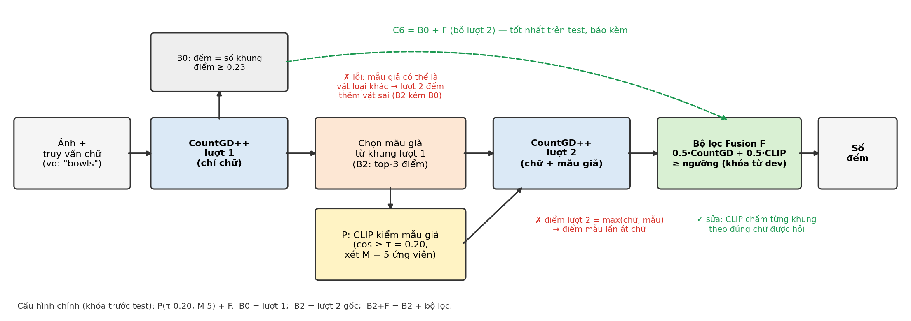
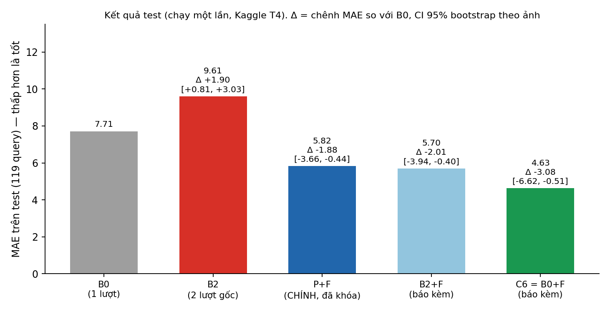
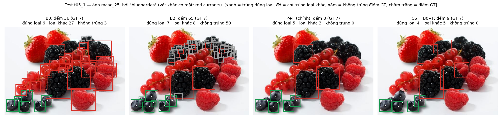
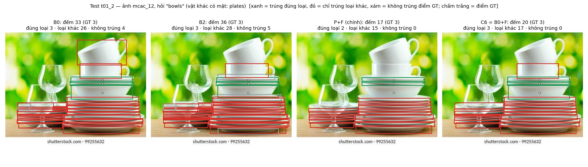

# 1. Bài toán

Đếm đối tượng **zero-shot bằng câu chữ**: đầu vào là ảnh và tên loại vật, đầu ra là số lượng. Câu hỏi trọng tâm (bài toán X/Y):

- trong cùng một ảnh có hai loại vật X và Y; hỏi X thì phải đếm X, đổi sang hỏi Y thì phải đếm Y, **không được đếm lại vật của X**;
- hỏi một loại **không có** trong ảnh thì phải trả về 0.

Mô hình nền là **CountGD++** (checkpoint công khai, không huấn luyện lại):

- **B0**: một lượt, chỉ dùng chữ.
- **B2**: hai lượt; lượt 2 dùng thêm các khung tốt nhất của lượt 1 làm mẫu giả.

Môi trường đã được kiểm tái lập trên FSCD-147: MAE 8.34, so với 8.39 trong bài báo.

# 2. Đã làm

| Bước | Nội dung | Kết quả chính |
|---|---|---|
| Pilot | 5 ảnh MUCCA (nhiều loại vật / ảnh), 15 query | CountGD++ đếm lẫn loại; **B2 kém B0** do mẫu giả tự chọn sai loại |
| Chẩn đoán cơ chế | Đọc điểm khung lượt 2; thử biến thể T (bỏ cách chấm max) trên dev | Điểm lượt 2 = max(điểm theo chữ, điểm theo mẫu). Bỏ max (T) chỉ gỡ khoảng **1/5** tác hại trên dev (MAE: B0 6.28, T 8.55, B2 9.15), nên max chỉ giải thích một phần. Giả thuyết (chưa kiểm): mẫu giả làm lệch cả cách mô hình hiểu câu chữ |
| Cải tiến | (P) CLIP kiểm mẫu giả trước lượt 2; (F) bộ lọc khung **Fusion** = 0.5·điểm CountGD++ + 0.5·điểm CLIP theo đúng chữ được hỏi | Không cần huấn luyện |
| Kiểm trên 10 ảnh mới | Cấu hình v1 khóa trước | Fusion: MAE 5.53 so với B0 6.77; đếm trung bình ở lớp vắng mặt 1.0 so với 8.9 |
| **Dữ liệu v2** | Rút từ MUCCA bằng quy tắc cố định (seed 331): **dev 20 ảnh + test 40 ảnh**. Mỗi ảnh có 2 lớp có mặt + 1 lớp vắng mặt; người kiểm từng nhãn; **khóa trước khi chạy model** | 1 query test bị loại do MUCCA gán sai loại (bút chì gán là bút) |
| **Chọn cấu hình** | Luật chọn **chốt trước** (D9): MAE nhỏ nhất trên dev, với điều kiện không kém B0 ở query có mặt và ở báo nhầm lớp vắng mặt | Chọn **P(τ 0.20, M 5)+F**; ngưỡng/min/max khóa vào file freeze |
| **Test** | Chạy **một lần duy nhất** trên Kaggle T4 với cấu hình đã khóa; người thứ hai tính lại độc lập, khớp tuyệt đối | Bảng dưới |

{width=100%}

# 3. Kết quả trên test (119 query: 79 có mặt, 40 vắng mặt)

| Cách | MAE | MAE có mặt | Tỉ lệ báo nhầm lớp vắng mặt | Δ MAE so với B0 [CI 95%, bootstrap theo ảnh] |
|---|---:|---:|---:|---|
| B0 (CountGD++ 1 lượt) | 7.71 | 8.32 | 0.25 | — |
| B2 (CountGD++ 2 lượt gốc) | 9.61 | 10.24 | 0.25 | +1.90 [+0.81, +3.03] |
| **P+F (phương pháp chính, đã khóa)** | **5.82** | **6.84** | **0.225** | **−1.88 [−3.66, −0.44]** |
| B2+F (đối chứng khai báo trước) | 5.70 | 6.81 | 0.25 | −2.01 [−3.94, −0.40] |
| C6 = B0+F (đối chứng khai báo trước) | 4.63 | 6.48 | 0.10 | −3.08 [−6.62, −0.51] |

{width=78%}

# 4. Phát hiện

1. **Có cải tiến được kiểm chứng trên tập test chưa từng xem:** so với CountGD++ một lượt (so sánh chính, khai báo trước), MAE giảm 24% (7.71 → 5.82); CI 95% [−3.66, −0.44] không chứa 0. So với hai lượt gốc, MAE giảm 39% (9.61 → 5.82). Phép so sánh cặp này không nằm trong kế hoạch kiểm định, nên nhóm chỉ báo con số mô tả, không khẳng định ý nghĩa thống kê.
2. **Lượt 2 tự chọn mẫu của CountGD++ gây hại** khi ảnh có nhiều loại vật: B2 kém B0, CI không chứa 0.
3. **Thành phần hiệu quả là bộ lọc Fusion F, không phải bước kiểm mẫu P:**
   - B2+F ≈ P+F (chênh −0.13, CI [−0.41, +0.18]);
   - áp F ngay sau lượt 1 (C6) cho số tốt nhất, nhưng chênh so với P+F chưa có ý nghĩa thống kê (−1.19, CI [−3.32, +0.24]).
4. **Phân tích khung (hậu kiểm, không dùng để chọn phương pháp):**
   - Đổi truy vấn X → Y, **64% khung của B0 vẫn là cùng các khung cũ** (B2: 71%). Với P+F con số là 59%, với C6 chỉ còn 24%.
   - Đối chiếu với điểm GT: khoảng **1/3 khung CountGD++ đếm là vật loại khác**. F dọn gần hết khung rác nền nhưng còn khoảng 33% khung sai loại; C6 còn 21%.
5. **Lỗi còn lại:**
   - nhầm loại cùng nhóm (đàn dê bị đếm là chó; chồng đĩa bị đếm là bát);
   - **lọc quá tay** ở ảnh đông người (31 người → P+F 13).
6. **Theo loại cặp (hậu kiểm):** cải thiện tập trung ở 27 ảnh cặp **dễ nhầm** (P+F so với B0: −3.05, CI [−5.43, −0.96]). Với 13 ảnh cặp **khác hẳn**, chưa thấy khác biệt chắc chắn (+0.51, CI [−0.72, +1.82]); bộ lọc có xu hướng đếm thiếu. Ngoài ra, P chọn lại đúng bộ mẫu của B2 ở 108/120 câu, nên P không tạo khác biệt.
7. **Thứ hạng của C6 và bài học chọn mô hình:**
   - Trên dev, C6 đứng **thứ 7/15** họ phương pháp (thứ 25/90 cấu hình riêng lẻ), MAE 4.02 so với 3.53 của P+F. Trên test, C6 tốt nhất trong 5 cách được báo (4.63 so với 5.82).
   - Ở **cả hai tập**, chênh lệch C6 − P+F đều nằm trong nhiễu: dev +0.48 [−0.62, +1.63], test −1.19 [−3.32, +0.24]. Vì vậy "đảo thứ hạng" không chứng minh C6 tốt hơn.
   - Giải thích hợp lý nhất là **lạc quan do chọn**: luật D9 lấy cấu hình nhỏ nhất trong khoảng 80 cấu hình gần bằng nhau trên 60 câu. Từ dev sang test, cấu hình thắng tăng MAE +2.29, trong khi C6 chỉ tăng +0.61 (B0 +1.42). C6 cũng ít tham số hơn (không có τ, M, lượt 2).
   - Nhóm vẫn báo P+F là kết quả chính đúng giao thức, và nêu C6 như giả thuyết cho lần kiểm tiếp theo (chi tiết: bản chi tiết mục 7.6).

{width=100%}

{width=100%}

# 5. Việc còn lại đến 02/12

| Thời gian | Việc | Người |
|---|---|---|
| 12–14/11 | Rà gói kết quả + hình; gửi bản tiến độ này | Trí |
| 15–25/11 | Viết báo cáo đầy đủ: giới thiệu, phương pháp, thiết lập, kết quả, phân tích lỗi, hạn chế | Trí (chính); Triệu: Related Work (CountGD++, PseCo, DAVE, PrACo++/MUCCA, VA-Count) |
| 26–30/11 | Slide, demo (ảnh trước/sau), tập thuyết trình | Cả nhóm |
| 01–02/12 | Rà soát, nộp | Cả nhóm |

Không chạy thêm thực nghiệm trên test. Các hướng mở chỉ ghi vào phần hướng phát triển:

- lọc ngay sau lượt 1;
- CLIP so sánh khung giữa các lớp trong cùng ảnh;
- ngưỡng thích ứng theo mật độ vật.

*Chi tiết và mã nguồn: repo `zero-shot-counting` — `reports/KET_QUA_TEST_CUOI_20261111.md`, `reports/PHAN_TICH_HAU_KIEM_TEST_20261111.md`, `results/countgdpp/freeze_v2_20261111.json`.*

*Bản trình bày chi tiết (khoảng 19 trang: nền tảng, định nghĩa, phương pháp, giao thức, kết quả từng giai đoạn, phân tích, hạn chế): `reports/BAO_CAO_CHI_TIET_DO_AN_20261112.pdf`.*
