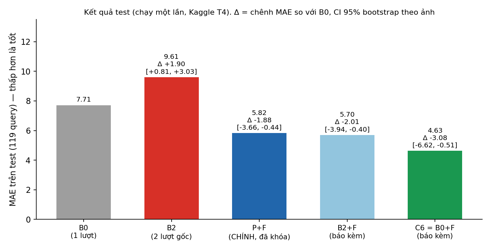
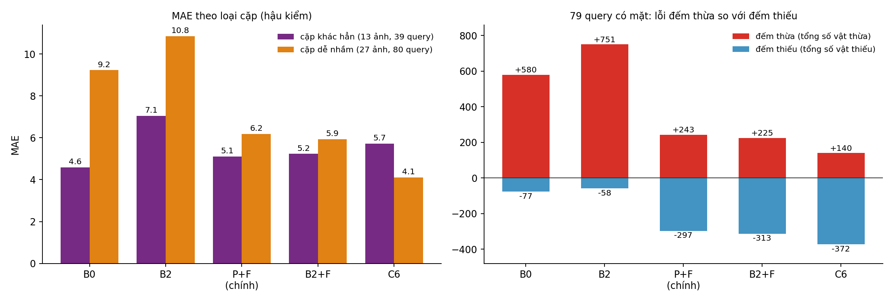
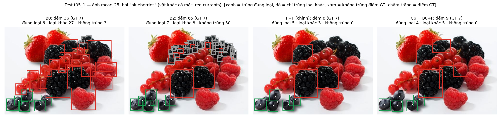
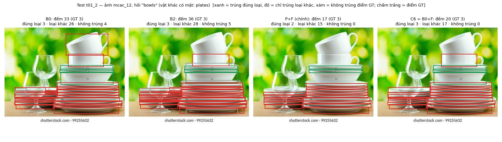
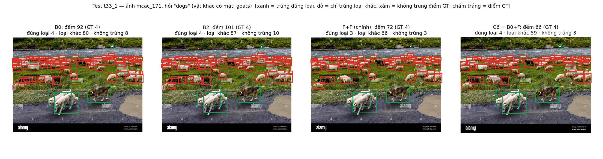
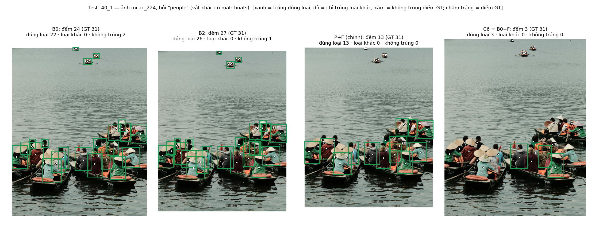

> **Cách dùng:** đọc mục 0 và 1 trong 10 phút là kể được đồ án. Mục 2–8 là chi tiết để trả lời câu hỏi. Mục 10 là "bảng số" để tra nhanh khi thuyết trình.
> Mọi con số trong file này lấy từ các báo cáo đã kiểm trong repo (nguồn ở mục 13). Chỗ nào chưa có kết quả thì ghi **"chờ"**, không đoán.
> Kế hoạch slide, kịch bản nói và câu hỏi phản biện nằm ở file riêng: [KE_HOACH_SLIDE_THUYET_TRINH.md](KE_HOACH_SLIDE_THUYET_TRINH.md).

# 0. Đồ án trong 5 câu

1. **Bài toán:** trong một ảnh có nhiều loại vật (bát và đĩa, người và chó…), hỏi "đếm bowls" thì mô hình phải đếm bát, không đếm đĩa. Hỏi một loại không có trong ảnh thì phải trả 0. Thầy gọi đây là **bài toán X/Y**.
2. **Mô hình:** CountGD++, mô hình đếm theo câu chữ mạnh hiện nay. Nhóm **không huấn luyện lại**, chỉ dùng checkpoint công khai.
3. **Phát hiện:** CountGD++ hay trả **cùng một nhóm khung dù đổi câu hỏi**. Chế độ hai lượt tự chọn mẫu (B2) còn **làm tệ hơn** một lượt (B0).
4. **Cải tiến:** thêm CLIP làm "người kiểm thứ hai". **P** kiểm mẫu trước lượt 2; **F** lọc khung bằng điểm kết hợp CountGD++ + CLIP. Cấu hình khóa: **P(τ 0.20, M 5) + F**.
5. **Kết quả trên test chạy một lần** (40 ảnh, 119 câu): MAE **7.71 → 5.82** so với B0 (−24%, CI 95% [−3.66, −0.44]). Thành phần thật sự có ích là **bộ lọc F**. Cải thiện tập trung ở **cặp vật dễ nhầm**.

# 1. Câu chuyện đồ án (kể theo thứ tự thời gian)

| Giai đoạn | Thời gian | Làm gì | Ra gì |
|---|---|---|---|
| 1. Dựng môi trường | 13–15/10 | Chạy CountGD++ trên Kaggle T4; benchmark FSCD-147 1.190 ảnh | MAE 8.34 so với bài báo 8.39, nên môi trường chạy đúng |
| 2. Pilot tìm lỗi | 14–20/10 | 5 ảnh MUCCA, 15 câu; B0 và B2; Trí xem bằng mắt 15/15 | B0 MAE 19.4, B2 22.0; mô hình đếm lẫn loại; chỉ 23/42 mẫu giả đúng loại |
| 3. Cải tiến v1 | 20–27/10 | Lọc khung B2 bằng điểm hoặc Fusion; ngưỡng chọn trên pilot, khóa | Trên 10 ảnh mới (p4_unseen_v1): Fusion MAE 5.53, B0 6.77, B2 13.00; nhưng bỏ khoảng nửa vật đúng |
| 4. Review khung bằng người (N4) | 27–29/10 | Triệu gán nhãn mù 117 khung của 7 câu lỗi | Mẫu giả chỉ 1/21 đúng loại; "people" và "cars" trùng 21/21 khung; lỗi bắt đầu từ mẫu giả |
| 5. Chốt hướng v2 | 05/11 | Quyết định D1–D10; chọn nhánh P + biến thể T; C6 là đối chứng bắt buộc | Kế hoạch v2 |
| 6. Dữ liệu v2 | 06–11/11 | Rút dev 20 + test 40 ảnh bằng script; Trí kiểm dev, Triệu kiểm test; khóa bằng hash | D11, D12; dữ liệu `LOCKED` 11/11 |
| 7. Dev | 11/11 | Triệu chạy dev trên Kaggle T4; chấm theo luật D9 | Chọn P(τ 0.20, M 5)+F, MAE dev 3.53 |
| 8. Khóa + test | 11/11 | Khóa cấu hình (freeze v2); Triệu chạy test **một lần**; assistant tính lại độc lập | P+F 5.82 so với B0 7.71; B2 9.61; C6 4.63 |
| 9. Hậu kiểm + báo cáo | 11–15/11 | Phân tích X/Y, theo loại cặp, P = B2, thứ hạng C6; bản chi tiết 22 trang | Giải thích được vì sao F giúp, vì sao P không giúp |
| 10. Khảo sát bổ sung FSC-147 | 20–24/11 | 300 ảnh một loại vật; câu hỏi: bỏ lượt 2 có hại không | Chạy 22/11: B0 − B2 chưa khác rõ; P+F kém hơn trên mẫu này (đếm thiếu ở ảnh dày) |
| 10b. Thử nghiệm sơ bộ "gán khung theo CLIP" | 22/11 | Chỉ trên dev, khai báo trước, Trí đồng ý; gán mỗi khung cho loại CLIP thấy giống nhất | Khung dùng chung X/Y 62% → 3%, nhưng MAE có mặt 5,05 → 6,92 (bỏ nhầm khoảng 30% vật đúng): đánh đổi |
| 11. Báo cáo, slide, nộp | đến 02/12 | Báo cáo cuối, slide, demo tĩnh, tập trình bày | — |

# 2. Thuật ngữ (nói được bằng lời thường)

| Thuật ngữ | Nói đơn giản |
|---|---|
| Zero-shot counting | Đếm loại vật mà mô hình chưa được dạy riêng; người dùng gõ tên loại lúc dùng |
| Query / câu hỏi | Một cặp (ảnh, tên loại), ví dụ (ảnh bàn ăn, "bowls") |
| Có mặt / vắng mặt | Loại được hỏi có / không có trong ảnh. Vắng mặt thì đáp án đúng là 0 |
| Khung (box) | Hình chữ nhật mô hình khoanh quanh một vật. Số đếm = số khung được giữ |
| Mẫu (exemplar) | Một khung đưa thêm vào để nói "vật trông như thế này" |
| Mẫu giả (pseudo-exemplar) | Mẫu do **chính mô hình** tự chọn từ lượt đầu |
| Lượt 1 / lượt 2 | Lượt 1: chỉ dùng chữ. Lượt 2: chữ + 3 mẫu giả lấy từ lượt 1 |
| CLIP | Mô hình chấm độ giống giữa một ô ảnh và câu "a photo of X". **CLIP không đếm** |
| GT | Đáp án đúng: số điểm người gán cho từng loại trong ảnh MUCCA |
| MAE | Trung bình sai số tuyệt đối của số đếm. Càng nhỏ càng tốt |
| RMSE | Như MAE nhưng phạt nặng lỗi lớn |
| FPR_absent | Tỉ lệ câu vắng mặt mà mô hình đếm > 0 (báo nhầm là có) |
| dev / test | dev dùng để chọn cách làm; test chỉ dùng **một lần** để đo kết quả cuối |
| Bootstrap theo ảnh | Lấy lại ngẫu nhiên các **ảnh** 5.000 lần để xem chênh lệch có chắc không |
| CI 95% | Khoảng tin cậy. Không chứa 0 thì chênh lệch được coi là chắc ở mức 95% |
| IoU | Diện tích giao chia diện tích hợp của hai khung; ≥ 0.5 thì coi là trùng |
| Hash (SHA-256) | "Dấu vân tay" của file; file đổi một byte thì hash đổi. Dùng để khóa dữ liệu và cấu hình |

# 2b. Phần nền tảng: vì sao bài toán này quan trọng

- Đếm vật có nhiều ứng dụng: người, xe, hàng hóa, tế bào, trái cây. Cách cũ huấn luyện riêng từng loại. **Đếm không phân biệt lớp** cho người dùng chỉ định loại lúc dùng, bằng vài khung mẫu hoặc bằng chữ.
- Benchmark chuẩn **FSC-147** (Ranjan và cộng sự, 2021) chủ yếu có **một loại nổi bật mỗi ảnh**. Vì vậy mô hình có thể đạt điểm cao chỉ bằng cách "đếm thứ nổi bật nhất", mà không thật sự hiểu câu chữ.
- **PrACo** (Ciampi và cộng sự, 2025) và **MUCCA / PrACo++** (Pacini và cộng sự, 2026) chỉ ra điểm yếu này. MUCCA có 200 ảnh thật, 45 loại vật, mỗi ảnh có nhãn điểm cho nhiều loại.
- **Đồ án làm khác ở chỗ:** không chỉ đo lỗi, mà **chẩn đoán cơ chế** gây lỗi trong một mô hình cụ thể, **đề xuất cách sửa không cần huấn luyện**, và kiểm bằng **giao thức khóa trước**.

# 3. Mô hình CountGD++ (đủ để giải thích trên slide)

**Cách đếm một lượt (B0):**

1. Mã hóa ảnh và câu chữ (ví dụ "bowls ."), rồi sinh rất nhiều khung đề xuất.
2. Mỗi khung có điểm cho từng token của câu. Điểm của khung là **giá trị lớn nhất** trên các token chữ.
3. Giữ khung có điểm **> 0.23**. Số đếm = số khung được giữ.

**Hai lượt (B2), cơ chế gốc của CountGD++:**

1. Chạy lượt 1 như B0.
2. Lấy tối đa **3 khung điểm cao nhất** (> 0.23) làm mẫu giả.
3. Chạy lượt 2 với chữ + 3 mẫu giả. Nếu lượt 1 không có khung nào qua ngưỡng thì trả kết quả B0.

> **Ví dụ đời thường (nên dùng khi trình bày):** lượt 1 giống người đếm đọc tên vật rồi khoanh những thứ trông giống. Lượt 2 giống việc người đó chỉ vào 3 vật mình chắc nhất và nói "đếm hết những thứ trông như mấy cái này". **Nếu 3 vật được chỉ vào sai loại, lượt 2 sẽ đếm sai một cách rất tự tin.**

**Chỗ lỗi tìm được khi đọc mã:** ở lượt 2, điểm khung lấy max trên **cả token chữ lẫn token mẫu**:

$$s_{\text{lượt 2}}(b) = \max\big(s_{\text{chữ}}(b),\ s_{\text{mẫu}}(b)\big)$$

Một khung chỉ cần **giống mẫu giả** là có điểm cao, dù không giống câu chữ.

**CLIP:** model `openai/clip-vit-base-patch32`, revision cố định. Mỗi khung được cắt ra rồi so với câu `a photo of {X}` bằng cosine. CLIP chỉ là **người kiểm thứ hai**.

# 4. Bài toán và cách đo

**Ba yêu cầu:**

- **Y1, có mặt:** hỏi loại có trong ảnh thì đếm gần đúng số thật.
- **Y2, vắng mặt:** hỏi loại không có thì trả 0.
- **Y3, độc lập X/Y:** khung trả về cho X và cho Y phải khác nhau.

**Dữ liệu đánh giá:** mỗi ảnh có 2 câu có mặt (X, Y) và 1 câu vắng mặt (Z). Z được chọn **khó**: cùng nhóm nghĩa với Y nếu có thể, và có người kiểm Z thật sự vắng.

**Chỉ số:**

- MAE trên cả tập (chính), MAE câu có mặt, FPR_absent, RMSE.
- Tổng đếm thừa / đếm thiếu: biết mô hình sai theo hướng nào.
- Hậu kiểm cho Y3:
  - **tỉ lệ khung dùng chung X/Y** (IoU ≥ 0.5);
  - **kiểm theo điểm GT**: khung chứa điểm đúng loại / chỉ chứa điểm loại khác / không chứa điểm nào.

**Vì sao bootstrap theo ảnh:** 3 câu trong một ảnh không độc lập (ảnh khó thì cả 3 cùng sai). Lấy mẫu lại theo câu thì CI hẹp giả tạo. Vì vậy nhóm lấy lại **40 ảnh** có hoàn lại, 5.000 lần, seed 331.

# 5. Các biến thể (bảng phải thuộc)

| Ký hiệu | Làm gì | Vai trò |
|---|---|---|
| **B0** | Một lượt, chỉ chữ, ngưỡng 0.23 | Mốc so sánh chính |
| **B2** | Hai lượt, 3 mẫu giả tự chọn | Cơ chế gốc CountGD++ |
| **P** (τ, M) | Như B2, nhưng xét M ứng viên điểm cao nhất của lượt 1, chỉ giữ ứng viên có cosine CLIP ≥ τ, lấy tối đa 3. Không còn ứng viên thì trả B0 | Sửa **đầu vào** lượt 2 |
| **T** | Lượt 2 chỉ chấm bằng token chữ, bỏ max với token mẫu | Phép thử cơ chế, sửa **cách chấm** |
| **S** | Lọc khung bằng ngưỡng điểm CountGD++ cao hơn 0.23 | Lọc đơn giản |
| **F** | Lọc bằng điểm kết hợp: F = 0.5·norm(CountGD++) + 0.5·norm(CLIP) ≥ θ | Lọc có người kiểm thứ hai |
| **C6** | B0 + F (bỏ hẳn lượt 2) | Đối chứng bắt buộc |

**Bộ lọc F của cấu hình chính** (khóa trong freeze v2):

- điểm CountGD++ chuẩn hóa trong [0.231, 0.982];
- cosine CLIP chuẩn hóa trong [0.123, 0.335];
- ngưỡng θ = 0.604.

Mỗi nguồn (B0, B2, P) có bộ min/max và ngưỡng riêng, chọn trên dev. Ví dụ C6 dùng θ = 0.427.

**Ví dụ số thật** (test t05_1, hỏi "blueberries", GT 7):

| Khung | Điểm CountGD++ | Cosine CLIP | F | Giữ? | Thực tế |
|---|---:|---:|---:|---|---|
| 1 | 0.911 | 0.251 | 0.753 | giữ | việt quất ✓ |
| 2 | 0.761 | 0.215 | 0.571 | bỏ | việt quất (bỏ nhầm ✗) |
| 3 | 0.888 | 0.274 | 0.793 | giữ | quả khác (giữ nhầm ✗) |
| 4 | 0.727 | 0.218 | 0.554 | bỏ | không có vật ✓ |

F dọn được khung rác, nhưng vừa bỏ nhầm vật đúng, vừa giữ nhầm vật sai loại khi CLIP cũng nhầm. Ở câu này cấu hình chính giữ 8/65 khung (GT 7).

**Vì sao không huấn luyện lại:**

1. Câu hỏi là về **chính mô hình công khai**.
2. MUCCA chỉ có 200 ảnh, không đủ để vừa huấn luyện vừa giữ tập kiểm độc lập.
3. Cách sửa ở đầu ra dễ tái lập trên Kaggle T4.

# 6. Dữ liệu và giao thức "chọn trước, xem sau"

| Tập | Ảnh / câu | Dùng để |
|---|---|---|
| FSCD-147 test | 1.190 ảnh | Chỉ để kiểm môi trường (MAE 8.34) |
| Pilot | 5 / 15 (toàn có mặt) | Tìm lỗi, thiết kế v1 |
| p4_unseen_v1 | 10 / 30 | Kiểm v1; review khung N4 |
| **dev v2** | 20 / 60 | Thử biến thể, chọn cấu hình |
| **test v2** | 40 / 120 (chấm 119) | Đo kết quả cuối, **một lần** |
| Khảo sát FSC-147 | 300 ảnh một loại | Kiểm bổ sung: bỏ lượt 2 có hại không (mục 9) |

**Rút dev/test v2** (`select_dev_test_v2.py`, chỉ đọc nhãn, không đọc output mô hình):

- bỏ 15 ảnh đã dùng;
- mỗi ảnh một cặp (X, Y), mỗi loại 3–40 điểm;
- lấy **hết** ảnh có cặp **khác hẳn** (người–xe), phần còn lại là cặp **dễ nhầm** (đĩa–bát), xoay vòng siêu nhóm;
- seed 331.

Kết quả rút: dev có 6 ảnh khác hẳn + 14 dễ nhầm; test có **13 khác hẳn + 27 dễ nhầm**. MUCCA chỉ có 19 ảnh cặp khác hẳn đủ điều kiện.

**Người kiểm nhãn:** Trí kiểm dev, Triệu kiểm test, xem ảnh gốc để xác nhận GT và xác nhận Z thật sự vắng.

**Năm bước của giao thức:**

1. **Luật D9**, chốt trước khi chạy dev: chọn cấu hình có MAE dev nhỏ nhất, **với điều kiện** MAE có mặt ≤ của B0 **và** FPR_absent ≤ của B0. Không cấu hình nào đạt thì báo kết quả âm.
2. Thử lưới τ ∈ {0.18 … 0.28}, M ∈ {5, 10}, cùng T, S, F, C6 trên dev.
3. **Khóa** vào `results/countgdpp/freeze_v2_20261111.json` (sha256 `64e89ef5…`), kèm 4 đối chứng báo kèm: B0, B2, C6, B2+F.
4. **Test chạy một lần** trên Kaggle T4 (Triệu). Chấm bằng một script đọc file khóa. Assistant tính lại từ đầu ra thô và **khớp tuyệt đối**.
5. Kết quả xấu cũng không chạy lại. Đối chứng không được đổi thành phương pháp chính sau khi xem test.

**Kiểm tái lập:**

- **Kiểm A:** lượt 1 trong run P trùng B0. Riêng CLIP trên Kaggle cho điểm giống bản đã lưu.
- **Kiểm C:** B2 chạy lại trùng B2 đã lưu, 60/60 trên dev.
- Mọi so sánh chỉ giữa các cách trong **cùng một lần chạy T4**.

> **Vì sao chặt như vậy (câu nên nói):** dữ liệu ít mà tham số nhiều, nên rất dễ vô tình chọn cấu hình hợp với ngẫu nhiên của tập đang nhìn. Khóa trước là cách để con số test là ước lượng **không thiên lệch**.

# 7. Quyết định đã chốt (D1–D12)

| # | Quyết định |
|---|---|
| D1 | Máy chuẩn T4 (Colab, sau chuyển Kaggle); tiêu chí tái hiện = Kiểm A + Kiểm C; chỉ so trong cùng một lần chạy |
| D2 | C6 được chọn lại ngưỡng S/F riêng trên dev, khóa trước test |
| D3 | Cỡ tập: dev 20 + test 40 ảnh |
| D4 | Mỗi loại 3–40 điểm (đếm tay được) |
| D5 | Cặp dễ nhầm lấy xoay vòng qua siêu nhóm |
| D6 | Không thêm câu vắng mặt loại dễ (7/10 đã trả 0 ngay ở lượt 1) |
| D7 | Seed 331 |
| D8 | Biến thể thử trên dev: B0, B2, P (lưới τ, M), T, P+T, F/S riêng từng nguồn, C6 |
| D9 | Luật chọn cấu hình cuối (xem mục 6) |
| D10 | Đưa vào repo file nhỏ (predictions, run_config, bảng đối chứng); bỏ `.npz` và ảnh |
| D11 | GT giữ đúng số điểm MUCCA; chỗ người đếm khác thì ghi `needs_review` và làm bảng độ nhạy |
| D12 | Loại t37_1 ("pens") khỏi chấm, vì MUCCA gán nhầm loại (đó là bút chì) |

# 8. Kết quả và phân tích

## 8.1 Pilot và v1

- Pilot (5 ảnh, 15 câu có mặt): B0 MAE 19.4, B2 22.0; mỗi cách chỉ đúng tuyệt đối 1/15. Ví dụ hỏi blackberries (GT 21), B2 đếm 79. Kết luận pilot phụ thuộc nhiều vào câu đó, nên chỉ dùng làm **giả thuyết**.
- v1 trên p4_unseen_v1 (10 ảnh mới, 30 câu):

| Cách | MAE 30 câu | MAE có mặt | Số đếm TB ở câu vắng mặt | Khung sai loại |
|---|---:|---:|---:|---:|
| B0 | 6.77 | **5.70** | 8.9 | 106 |
| B2 | 13.00 | 12.95 | 13.1 | 238 |
| B2 + lọc điểm | 7.27 | 8.75 | 4.3 | 92 |
| **B2 + Fusion** | **5.53** | 7.80 | **1.0** | **31** |

Fusion giảm mạnh báo nhầm, nhưng **bỏ khoảng nửa vật đúng**. Vì vậy v2 chuyển sang sửa **nguồn lỗi** (mẫu giả) thay vì chỉ lọc ở cuối.

## 8.2 N4: review khung bằng người

Triệu gán nhãn mù 117 khung của 7 câu lỗi có chủ đích; Trí và Triệu đồng ý 9/9 ở câu chồng nhau. Đây là phân tích lỗi, không phải mẫu đại diện.

- Khung bộ lọc giữ lại có **0 khung đúng loại** (ví dụ hỏi "people": 9/9 khung là chó).
- Mẫu giả: **chỉ 1/21 đúng loại**.
- Ảnh mcac_88: hỏi "people" và hỏi "cars" ra **21/21 khung trùng nhau**.
- Vật đúng **có** trong ứng viên nhưng bị lọc mất (13/18 ứng viên là người thật).

## 8.3 Chẩn đoán cơ chế lượt 2: biến thể T

| Tập | B0 | T (bỏ max) | B2 | Phần tác hại T gỡ được | T so với B0 |
|---|---:|---:|---:|---|---|
| dev v2 | 6.28 | 8.55 | 9.15 | **21%** [5%, 60%] | +2.27 [+0.52, +4.12] |
| p4_unseen_v1 | 6.77 | 8.80 | 13.00 | 67% | +2.03 [−0.37, +5.33] |

- Bỏ max **có giúp** (trên dev, B2 − T = +0.60 [+0.12, +1.23]), nhưng T vẫn kém B0. Vậy max chỉ giải thích **một phần**.
- **Giả thuyết H2 (chưa kiểm):** mẫu giả làm lệch chính điểm theo chữ. Token chữ và token mẫu đi cùng nhau qua các lớp kết hợp đặc trưng, nên điểm "giống bowls" đã bị kéo theo mẫu giả. Đây là giả thuyết, **không nói như kết luận**.

## 8.4 Dev v2 (20 ảnh, 60 câu)

| Cách | MAE | MAE có mặt | FPR_absent |
|---|---:|---:|---:|
| B0 | 6.28 | 8.25 | 0.20 |
| B2 | 9.15 | 12.00 | 0.20 |
| **P(τ 0.20, M 5) + F** | **3.53** | **5.05** | **0.05** |
| B2 + F | 3.73 | 5.15 | 0.20 |
| P + T + F | 3.78 | | |
| C6 = B0 + F | 4.02 | 5.80 | 0.05 |

D9 chọn **P(τ 0.20, M 5)+F**. Các cách đứng đầu sát nhau, ngưỡng chọn ngay trên dev, nên số dev **lạc quan**.

## 8.5 Kết quả cuối trên test (40 ảnh, 119 câu: 79 có mặt, 40 vắng mặt)

| Cách | MAE | MAE có mặt | FPR_absent | ΔMAE so với B0 [CI 95%] |
|---|---:|---:|---:|---|
| B0 | 7.71 | 8.32 | 0.250 | — |
| B2 | 9.61 | 10.24 | 0.250 | +1.90 [+0.81, +3.03] |
| **P+F (chính, khóa)** | **5.82** | **6.84** | **0.225** | **−1.88 [−3.66, −0.44]** |
| B2+F (báo kèm) | 5.70 | 6.81 | 0.250 | −2.01 [−3.94, −0.40] |
| C6 = B0+F (báo kèm) | 4.63 | 6.48 | 0.100 | −3.08 [−6.62, −0.51] |

- So sánh cặp: C6 − P+F = −1.19 [−3.32, +0.24], **chưa đủ chắc**; B2+F − P+F = −0.13 [−0.41, +0.18], **gần như bằng nhau**.
- Độ nhạy D11 (dùng số người đếm thay GT): MAE đổi dưới 0.06, thứ tự không đổi.
- **Cách nói đúng:**
  - "Giảm 24% so với một lượt, CI không chứa 0."
  - "Giảm 39% so với hai lượt gốc" **chỉ là con số mô tả**: so sánh này không nằm trong kế hoạch kiểm định.

## 8.6 Vì sao lượt 2 gây hại

B2 kém B0 có ý nghĩa thống kê trên test. Đây là lần thứ 3 thấy điều này, sau pilot và p4_unseen_v1. Ở 79 câu có mặt:

- B0 đếm thừa 580, thiếu 77;
- B2 đếm thừa 751, thiếu 58.

Lượt 2 thêm khung, chủ yếu khung sai.

## 8.7 Vì sao P không đóng góp

**P chọn y hệt bộ mẫu của B2 ở 108/120 câu (90%).** Với M = 5 và τ = 0.20 (ngưỡng khá thấp), 3 ứng viên đầu thường đều qua ngưỡng. Tỉ lệ mẫu đúng loại chỉ tăng từ 82% lên 85%. Vì vậy B2+F ≈ P+F. P đúng hướng nhưng **quá nhẹ tay**.

## 8.8 F thật sự làm gì

| Cách | Khung giữ | Đúng loại | Chỉ loại khác | Không trúng |
|---|---:|---:|---:|---:|
| B0 | 1481 | 60.4% | 34.6% | 5.1% |
| B2 | 1671 | 56.6% | 34.6% | 8.8% |
| P+F | 924 | 66.3% | 32.7% | 1.0% |
| C6 | 746 | **76.9%** | **21.3%** | 1.7% |

Tỉ lệ khung dùng chung khi đổi X → Y: B0 64%, B2 71%, P+F 59%, B2+F 59%, **C6 24%**.

- F **đổi lỗi đếm thừa thành đếm thiếu**: đếm thừa 580 → 243, đếm thiếu 77 → 297 (B0 → P+F).
- Áp sau lượt 2, F chủ yếu **dọn khung rác**, nhưng **chưa tách được X với Y**.
- Áp ngay sau lượt 1 (C6), F tách rõ hơn.
- Ở câu vắng mặt, 92–100% khung đếm nhầm nằm trên **vật khác có thật** trong ảnh. Mô hình "trỏ lại" vào vật có sẵn thay vì trả 0.

## 8.9 Theo loại cặp (hậu kiểm)

| Cách | Cặp khác hẳn (13 ảnh): MAE / Δ so với B0 | Cặp dễ nhầm (27 ảnh): MAE / Δ so với B0 |
|---|---|---|
| B0 | 4.59 / — | 9.23 / — |
| B2 | 7.05 / +2.46 [+0.38, +4.74] | 10.85 / +1.63 [+0.39, +2.86] |
| **P+F** | 5.10 / +0.51 [−0.72, +1.82] | **6.18 / −3.05 [−5.43, −0.96]** |
| C6 | 5.72 / +1.13 [−0.87, +3.51] | **4.10 / −5.13 [−10.16, −1.60]** |

- **Cải thiện đến từ cặp dễ nhầm.**
- Ở cặp khác hẳn (đúng dạng X/Y ban đầu), B0 đã khá tốt; các cách lọc **chưa khác biệt chắc** và có xu hướng đếm thiếu. Bù lại, C6 giảm báo nhầm vắng mặt ở nhóm này (FPR 0.46 → 0.08).
- Nhóm khác hẳn chỉ có 13 ảnh, nên **thiếu lực thống kê**.
- **Đây là điểm phải chủ động nói với thầy.**

## 8.10 Bốn ví dụ (dùng cho slide/demo tĩnh)

Màu khung: xanh = đúng loại; đỏ = loại khác; xám = không trúng vật. Chấm trắng = điểm GT của loại được hỏi.

| Hình | Loại | Câu chuyện |
|---|---|---|
|  | Thành công | "blueberries", GT 7: B0 36, B2 65, **P+F 8**, C6 9. B2 thêm 50 khung xám là từng hạt của quả mâm xôi |
|  | Lỗi X/Y còn lại | "bowls", GT 3: chồng đĩa bị đếm là bát ở mọi cách (P+F 17, C6 20) |
|  | Thất bại | "dogs", GT 4: ảnh có 80 cừu, 7 dê, 4 chó; đàn cừu (cùng vài con dê) bị đếm là chó (66–101) ở mọi cách; CLIP không tách được dê với chó ở ô nhỏ |
|  | Lọc quá tay | "people", GT 31: không có khung sai loại, nhưng F bỏ cả người thật (P+F 13, C6 3) |

## 8.11 Thứ hạng C6 và bài học chọn mô hình

| | Dev | Test |
|---|---|---|
| Thứ hạng C6 | 25/90 cấu hình; 7/15 họ phương pháp | 1/5 cách được báo |
| MAE C6 / P+F | 4.02 / 3.53 | 4.63 / 5.82 |
| C6 − P+F [CI] | +0.48 [−0.62, +1.63] | −1.19 [−3.32, +0.24] |

Từ dev sang test: B0 +1.42, **P+F +2.29** (hụt nhiều nhất), B2+F +1.96, **C6 +0.61** (hụt ít nhất).

**Giải thích, từ chắc nhất tới chỉ là giải thích:**

1. Thứ hạng nằm trong nhiễu ở cả hai tập (CI chứa 0).
2. "Lời nguyền người thắng": D9 lấy MAE nhỏ nhất trong khoảng 80 cấu hình gần bằng nhau, nên cấu hình thắng thường là cấu hình gặp may.
3. C6 có ít tham số hơn.
4. Về cơ chế: C6 lọc trước khi lượt 2 kịp thêm khung sai.

**Bài học:** khi các cách đứng đầu nằm trong cùng khoảng nhiễu, nên ưu tiên cách **đơn giản hơn**, hoặc dùng dev lớn hơn. Nhóm **không đổi** kết quả chính sau khi xem test. C6 là **giả thuyết mạnh cho lần kiểm sau**.

## 8.12 Chi phí

Trên T4: B0 khoảng 0.89 s/câu; B2 và P khoảng 1.5 s/câu, chưa tính CLIP (runner không ghi thời gian CLIP). C6 bỏ lượt 2 nên tiết kiệm khoảng 40% thời gian CountGD++.

# 9. Khảo sát bổ sung FSC-147 (300 ảnh)

- **Câu hỏi:** trên ảnh **một loại vật**, giữ lượt 2 hay bỏ lượt 2 cho kết quả đếm tốt hơn?
- **Vì sao cần:** thầy có thể hỏi "bỏ lượt 2 có làm hỏng ảnh bình thường không?". Nhóm Hoàng Anh – Duy cũng kiểm trên nhiều bộ dữ liệu.
- **Thiết kế:**
  - mẫu cố định 300 ảnh FSC-147 test, seed 331;
  - một lần chạy, 5 cách;
  - so sánh chính **B0 − B2**; phụ P+F − B2, P+F − B0; C6 − B2+F chỉ mô tả;
  - `crop=False`, `synthetic=False`;
  - bootstrap ghép cặp theo ảnh.
- **Trạng thái:** self-test dữ liệu giả PASS (20/11); notebook ghim `4cd8909…`. **Triệu chạy thay Trí ngày 22/11**, run `fsc147_survey_kaggle_t4_20261122_1618`: hoàn tất 300/300 câu. Assistant kiểm độc lập B/C: **PASS**. Log Kaggle xác nhận Kiểm A của notebook đạt (lệch lớn nhất 3.28e-07). Chi tiết: `reports/TRIEU_FSC147_KHAO_SAT_20261122.md`.
- **Kết quả** (300 ảnh, mọi câu có mặt):

| Cách | MAE | RMSE | Bias | Ghi chú |
|---|---:|---:|---:|---|
| B0 | 13,88 | 49,00 | −1,54 | |
| B2 | **13,32** | 48,62 | −0,23 | tốt nhất trên mẫu này |
| P+F | 18,01 | 55,21 | −14,68 | thiếu 4.904 vật (B2: 2.033) |
| C6 | 25,11 | 71,55 | −20,93 | kém nhất; 36 câu trả 0 |
| B2+F | 17,98 | 53,18 | −14,79 | |
| **B0 − B2** [CI] | +0,55 [−3,00; +4,30] | | | **chưa thấy khác biệt rõ** (CI chứa 0); cả hai nhóm ≤ 40 / > 40 cũng chứa 0 |
| P+F − B2 [CI] | +4,69 [+2,25; +7,50] | | | P+F kém hơn B2 trên mẫu này |
| P+F − B0 [CI] | +4,14 [+0,56; +8,09] | | | P+F kém hơn B0 trên mẫu này |

- **Đọc kết quả:**
  - Trên ảnh một loại, **giữ hay bỏ lượt 2 chưa khác nhau rõ**.
  - **Cấu hình đã khóa kém hơn**, chủ yếu ở ảnh > 40 vật (MAE P+F 35,28 so với B2 25,09), và lỗi chủ yếu là **đếm thiếu**: ở nhóm này thiếu 4.416 so với 1.910 (toàn mẫu 4.904 so với 2.033).
  - Một giải thích **có thể** là bộ lọc F chọn trên MUCCA 3–40 vật nên lọc quá tay; khảo sát **chưa tách được** mật độ vật với khác biệt giữa hai bộ dữ liệu.
  - Ở ảnh ≤ 40 vật, P+F và B2 **gần nhau** (3,50 so với 3,44); không kiểm định tương đương.
  - → Phạm vi của cải tiến: ảnh nhiều loại, ít đến vừa vật. Ảnh dày, một loại thì giữ CountGD++ gốc.

- **Giới hạn khi nói:**
  - chỉ áp dụng cho mẫu và điều kiện này, không phải benchmark đầy đủ;
  - không nói gì về lớp vắng mặt;
  - CI chứa 0 nghĩa là "chưa thấy khác biệt rõ", không phải "không hại";
  - không so với 8.34 / 10.29.
- **Nếu không kịp:** ghi vào hạn chế "chưa kiểm trên ảnh một loại vật".
- Chi tiết: `experiments/fsc147_survey/KHAI_BAO_TRUOC_FSC147_20261120.md`.

# 10. Bảng số tra nhanh (thuộc lòng các số in đậm)

| Nội dung | Số |
|---|---|
| Benchmark FSCD-147 (kiểm môi trường) | MAE 8.34 / RMSE 24.64 (bài báo 8.39 / 27.03) |
| Pilot B0 / B2 | 19.4 / 22.0 |
| v1 trên 10 ảnh mới: B0 / B2 / Fusion | 6.77 / 13.00 / 5.53 |
| N4: mẫu giả đúng loại | **1/21** |
| N4: "people" và "cars" trùng | **21/21 khung** |
| Dev: B0 / B2 / P+F / C6 | 6.28 / 9.15 / **3.53** / 4.02 |
| **Test: B0 / B2 / P+F / C6 / B2+F** | **7.71 / 9.61 / 5.82 / 4.63 / 5.70** |
| **Test P+F so với B0** | **−1.88 [−3.66, −0.44], −24%** |
| Test B2 so với B0 | +1.90 [+0.81, +3.03] |
| FPR_absent test: B0 / P+F / C6 | 0.25 / 0.225 / 0.10 |
| P = B2 ở | **108/120 câu** |
| Khung dùng chung X/Y: B0 / P+F / C6 | **64% / 59% / 24%** |
| Khung sai loại: B0 / P+F / C6 | 34.6% / 32.7% / 21.3% |
| Đếm thừa / thiếu: B0 → P+F | +580/−77 → +243/−297 |
| Cặp dễ nhầm, P+F so với B0 | **−3.05 [−5.43, −0.96]** |
| Cặp khác hẳn, P+F so với B0 | +0.51 [−0.72, +1.82] (chưa chắc) |
| T gỡ được tác hại lượt 2 | 21% dev, 67% p4 |
| Thời gian T4: B0 / B2 | 0.89 / khoảng 1.5 s/câu |
| Thời gian chấm CLIP (FSC-147, T4) | 404 s / 300 câu, tổng cho khung của cả 3 nguồn (B0, B2, P); không phải thời gian CLIP riêng một cấu hình |
| **FSC-147 300 ảnh: B0 / B2 / P+F / C6** | 13,88 / **13,32** / 18,01 / 25,11 |
| FSC-147: B0 − B2 (chính) | +0,55 [−3,00; +4,30], chưa khác rõ |
| **FSC-147: P+F − B2** | **+4,69 [+2,25; +7,50]** (kém hơn; ảnh > 40 vật: 35,28 so với 25,09) |
| **Dev, gán khung theo CLIP: khung dùng chung X/Y** | **61,6% → 2,9%** |
| Dev, gán khung theo CLIP: MAE có mặt | 5,05 → 6,92 (+1,88 [−0,03; +3,73]); bỏ 30% khung đúng loại |
| Cấu hình khóa | P(τ 0.20, M 5)+F, θ 0.604; freeze sha `64e89ef5…` |
| Dữ liệu | MUCCA 200 ảnh, 45 loại; test 40 ảnh = 13 khác hẳn + 27 dễ nhầm |

# 11. Hạn chế (nói chủ động, đừng đợi bị hỏi)

1. Cỡ mẫu nhỏ: 40 ảnh test, chỉ 13 ảnh cặp khác hẳn; CI rộng.
2. Một nguồn dữ liệu (MUCCA). Khảo sát FSC-147 là bổ sung, chỉ có câu có mặt.
3. Nhãn: 15/120 câu test có ghi chú cần xem lại (độ nhạy không đổi kết luận). Phép kiểm "điểm trong khung" dễ dãi.
4. F dùng một ngưỡng toàn cục, nên ảnh đông vật có thể bị lọc quá tay. **FSC-147 phù hợp với điều này:** P+F kém CountGD++ gốc ở ảnh > 40 vật, chủ yếu do đếm thiếu (nguyên nhân chưa tách được). Phạm vi cải tiến: ảnh nhiều loại, ít đến vừa vật.
5. CLIP yếu với ô cắt nhỏ và loại gần nghĩa (dê–chó–cừu). **Thử nghiệm dev xác nhận:** gán khung theo CLIP bỏ nhầm khoảng 30% khung đúng loại.
6. Lạc quan do chọn trên dev: thứ hạng đổi trên test.
7. Phân tích cơ chế lượt 2 làm trên dev và tập chẩn đoán; chưa có T trên test; H2 chưa kiểm.
8. Thời gian CLIP chỉ ghi ở khảo sát FSC-147, dưới dạng tổng bước chấm cho 3 nguồn khung; chưa đo riêng từng cấu hình, chưa đo trên test MUCCA.
9. **Bài X/Y chưa giải xong:** sau cải tiến, sai số câu có mặt vẫn khoảng một nửa số vật thật (MAE 6,84 trên trung bình 12,4 vật).

# 12. Hướng phát triển

1. Kiểm C6 (lọc ngay sau lượt 1) trên một tập mới, độc lập; cần kèm ngưỡng theo mật độ (C6 kém nhất trên FSC-147 ảnh dày).
2. **So sánh tương phản giữa các loại:** chấm mỗi khung bằng CLIP với *mọi* tên loại trong ảnh, rồi gán khung cho loại giống nhất. Đây là cùng một mô hình, cùng một thang điểm. Cách này khác hướng "giành khung bằng điểm CountGD++" mà nhóm khác thử thất bại.
   - **Đã thử sơ bộ trên dev (22/11):** khung dùng chung X/Y 62% → 3%, nhưng MAE có mặt 5,05 → 6,92, vì CLIP bỏ nhầm khoảng 30% vật đúng. Chi tiết: `reports/XY_CLIP_ASSIGN_DEV_KET_QUA_20261122.md`.
   - **Bước tiếp:** chỉ phân xử những khung bị X và Y tranh nhau; dùng bộ kiểm mạnh hơn.
3. Ngưỡng thích ứng theo mật độ vật (khảo sát FSC-147 cho thấy cần).
4. Kiểm H2: so điểm token chữ của cùng khung ở lượt 1 và lượt 2.
5. Dùng negative prompt "không đếm X" có sẵn trong CountGD++.

# 12b. So với nhóm Hoàng Anh – Duy (cùng dùng CountGD++)

Tóm tắt từ bản so sánh của Triệu (19/11). **Trong báo cáo không ghi tên nhóm**; chỉ dùng để trả lời nếu được hỏi.

- **Nhóm kia:** sửa CountGD++ trên ảnh **một loại** (FSC-147), nhắm ba lỗi: đếm 0 dù có vật, đếm thừa, đếm "ma". Họ dùng CLIP **cho cả ảnh** ("ảnh có X không?").
- **Nhóm mình:** làm thẳng trên ảnh **nhiều loại**, chẩn đoán cơ chế lượt 2, và dùng CLIP **cho từng khung**.
- **Câu trả lời mẫu:**
  > "Nhóm bạn sửa CountGD++ cho ảnh một loại rồi kiểm trên ảnh nhiều loại. Nhóm em làm thẳng trên ảnh nhiều loại, chẩn đoán vì sao lượt 2 làm đếm lẫn loại, và dùng CLIP kiểm từng khung chứ không kiểm cả ảnh, nên xử lý được cả lúc X và Y cùng có mặt."
- Cổng CLIP cả ảnh **không giải được X/Y**: khi bát và đĩa cùng có mặt, hỏi "bowls" thì cổng vẫn mở.
- Lớp vắng mặt của nhóm mình **khó hơn**: cùng nhóm nghĩa, có người kiểm. Lớp vắng mặt của nhóm kia là ngẫu nhiên. FPR hai nhóm **không so trực tiếp được**.
- Hai nhóm cùng có số FSCD-147 8.34 / 24.64 vì dùng cùng checkpoint và cùng chế độ. Đây là bình thường.

# 13. Repo: tìm gì ở đâu

Repo: `github.com/minhtridaoo/zero-shot-counting`.

| Cần | File |
|---|---|
| Bản chi tiết 22 trang (khung báo cáo cuối) | `reports/BAO_CAO_CHI_TIET_DO_AN_20261112.md` (+ .docx/.pdf) |
| Bản tóm tắt gửi thầy | `reports/BAO_CAO_TIEN_DO_GUI_THAY_20261111.md` |
| Kết quả test cuối, kiểm độc lập | `reports/KET_QUA_TEST_CUOI_20261111.md` |
| Phân tích hậu kiểm | `reports/PHAN_TICH_HAU_KIEM_TEST_20261111.md` |
| Dev + D9 | `reports/DEV_V2_D9_KET_QUA_20261111.md`, `reports/TRIEU_W6_DEV_D9_20261111.md` |
| Pilot, v1, N4 | `reports/PILOT_SUMMARY.md`, `P4_6_UNSEEN_RESULTS_20261027.md`, `N4_KET_QUA_TANG_A_20261029.md` |
| Quyết định D1–D10 | `reports/KE_HOACH_TIEP_THEO_20261105.md` |
| Benchmark FSCD-147 | `reports/BENCHMARK_FSCD147.md` |
| Cấu hình khóa | `results/countgdpp/freeze_v2_20261111.json` |
| Dữ liệu khóa | `experiments/countgdpp/dev_test_v2/` |
| Hình | `reports/figures/` (script `evaluation/make_report_figures.py`) |
| Khảo sát FSC-147 | `experiments/fsc147_survey/`, `reports/TRIEU_FSC147_KHAO_SAT_20261122.md` |
| Thử nghiệm gán khung theo CLIP (dev) | `experiments/xy_clip_assign/`, `reports/XY_CLIP_ASSIGN_DEV_KET_QUA_20261122.md` |
| Điểm yếu + hướng giải quyết | `reports/TRIEU_DIEM_YEU_VA_HUONG_GIAI_QUYET_20261122.md` |
| Related Work (nháp) | `reports/RELATED_WORK_TRIEU_20261122.md` |
| So sánh nhóm khác | `workspace Trí and Triệu/Triệu/so sánh/TRIEU_SO_SANH_NHOM_KHAC_DE_XUAT_20261119.md` |
| Báo cáo cuối + slide (LaTeX) | `final/report/main.tex`, `final/slides/main.tex`, `final/refs.bib` |
| Phân công Trí – Triệu | `reports/PHAN_CONG_TRI_TRIEU_BAO_CAO_SLIDE.md` |
| Trạng thái + nhật ký | `BAT_DAU_SESSION_MOI.md`, `WORKLOG.md` |
| Việc Triệu hôm nay | `HANDOFF/TRIEU_NGAY_22_11_CHOT_DO_AN.md` |

# 14. Tình trạng 6 sản phẩm phải nộp (23/11)

| # | Sản phẩm | Trạng thái |
|---|---|---|
| H1 | Báo cáo cuối | **Nháp LaTeX đầy đủ 23/11:** `final/report/main.pdf` (21 trang, gộp Related Work, FSC-147, thử nghiệm dev). Còn: điền tên/MSSV/giảng viên, hai bạn rà theo phân công, chốt khai báo AI |
| H2 | Bảng kết quả test | ✅ Xong 11/11 |
| H3 | Slide + demo | **Slide Beamer 23/11:** `final/slides/main.pdf` (bản 2: 30 slide nội dung + 4 dự phòng), kịch bản nói `final/slides/notes.pdf`; demo tĩnh bằng 4 hình ví dụ. Phân công nói: [PHAN_CONG_TRI_TRIEU_BAO_CAO_SLIDE.md](PHAN_CONG_TRI_TRIEU_BAO_CAO_SLIDE.md) |
| H4 | Repo tái lập | Phần lớn có |
| H5 | Pilot đóng | ✅ 11/11 |
| H6 | Kết luận trung thực | ✅ |
| H7 | Khảo sát FSC-147 | ✅ Chạy 22/11, kiểm độc lập PASS (mục 9) |
| — | Thử nghiệm sơ bộ hướng 1 (dev) | ✅ Chạy 22/11; đánh đổi (mục 12) |

# 15. Tài liệu tham khảo (đã kiểm trong bản chi tiết)

- Amini-Naieni, Han & Zisserman (2024). CountGD. NeurIPS 2024. arXiv:2407.04619.
- Amini-Naieni & Zisserman (2025). CountGD++. arXiv:2512.23351 (CVPR 2026).
- Ciampi và cộng sự (2025). PrACo. WACV 2025. arXiv:2409.15953.
- Pacini và cộng sự (2026). MUCCA / PrACo++. arXiv:2605.02752; dữ liệu Zenodo 19231375.
- Liu và cộng sự (2024). Grounding DINO. ECCV 2024.
- Radford và cộng sự (2021). CLIP. ICML 2021.
- Ranjan và cộng sự (2021). FSC-147. CVPR 2021.
- Efron (1979). Bootstrap.
- PseCo, DAVE, VA-Count: **chờ Triệu kiểm trích dẫn** trong Related Work.
